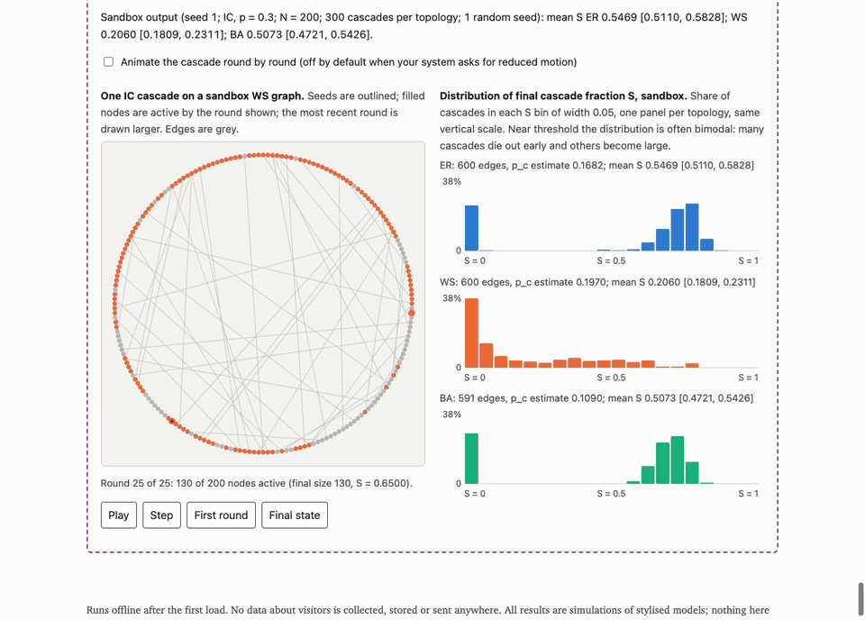

<!-- SPDX-License-Identifier: LicenseRef-VIRAL-NC-Research-1.0 -->
# VIRAL: network topology, initial exposure and diffusion

**Question.** How do network topology and initial exposure influence diffusion independently of content quality?

**Why it matters.** Two pieces of content of identical appeal can reach very different audiences. In observational data, content and network co-vary, so their roles are hard to separate. In a simulation, content quality can be held fixed by construction and the structural question asked directly.

**Status, 2026-11-25 (M5).** Simulation study. The protocol (v1.0) was frozen on 2026-11-24 with the owner's approval, before any confirmatory run. All five registered experiments are complete, each with a standalone report. The integrated manuscript is at version 0.2, an independent preprint draft that is not peer-reviewed; the owner approved its title and its funding, competing-interest and AI-use statements on 2026-11-25, and the owner's full-text review is pending (M6). Nothing has been published. All results are simulations of stylised models; nothing in this repository describes a real social platform, its algorithms, real people or any guarantee of virality.



*The interactive page (`demo/`): published results with their intervals, and a sandbox that runs the ported engine in the browser. Demo URL: [placeholder, not published].*

## Key findings (verified; from manuscript version 0.2)

All findings are simulations at N = 1000 and mean degree 6, comparing Watts-Strogatz (WS) and Barabasi-Albert (BA) graphs with Erdos-Renyi (ER) graphs. The smallest effect size of interest (SESOI) is plus or minus 0.02 in final cascade fraction S.

- **Independent cascade (EXP-002, primary).** Holm rejects 13 of 14 per-`p` contrasts, but only 7 of 14 intervals lie outside the SESOI; six rejections are detectable yet negligible. Both contrasts change sign with `p`: BA exceeds ER near threshold (+0.0969 [+0.0921, +0.1018] at `p` = 0.20) and falls below it at larger `p`, while WS falls far below ER at `p` = 0.30 (-0.3529 [-0.3601, -0.3456]). WS - ER at `p` = 0.02 is not rejected and lies inside the SESOI.
- **Sensitivity (EXP-004).** A degree-preserving null makes the BA advantage near threshold disappear (S2), so it is a degree-sequence effect. Exact edge matching (S3) and two other sizes (S4, optional) leave the pattern unchanged. S1 (threshold rescaling) is reported per multiplier with no overall verdict (owner decision D-013).
- **Threshold model (EXP-003).** The WS ordering reverses: +0.3664 [+0.3602, +0.3727] on the grid mean of `phi`.
- **One real network (EXP-005).** On one 362-node friendship network, structure beyond the degree sequence lowers final size by up to 0.1317; Holm rejects 11 of 14.
- **Exploratory, post hoc (M4).** On fresh seeds, the WS deficit at `p` = 0.30 comes from structure beyond the degree sequence (WS - ws_dpr -0.3662 [-0.3750, -0.3573]). This never replaces a frozen verdict.

Within these models, topology effects are large but are not one effect: their sign and size depend on `p` and on the contagion rule.

## Research navigation

| Item | Location | Status |
|---|---|---|
| Manuscript | [research/paper/manuscript.md](research/paper/manuscript.md), [supplementary.md](research/paper/supplementary.md) | version 0.2, not peer-reviewed; PDFs: [manuscript.pdf](research/paper/manuscript.pdf), [supplementary.pdf](research/paper/supplementary.pdf) |
| Protocol | [research/protocol.md](research/protocol.md), [research/freeze.json](research/freeze.json) | v1.0, frozen 2026-11-24 (owner-approved) |
| Experiment registry | [research/experiment_registry.csv](research/experiment_registry.csv) | 5 registered experiments |
| Claims register | [research/claims_register.csv](research/claims_register.csv) | 575 rows |
| Evidence audit | [research/publication/evidence_audit.md](research/publication/evidence_audit.md) | 0 untraced numbers |
| Limitations | [research/limitations.md](research/limitations.md) | |
| Interactive page | [demo/](demo/) | M5; offline static page |
| Articles (drafts) | [articles/medium.md](articles/medium.md), [articles/linkedin.md](articles/linkedin.md) | drafts, not published |
| Roadmap and progress | [roadmap.md](roadmap.md), [progress.md](progress.md) | |

| Experiment | Question | Status | Report |
|---|---|---|---|
| EXP-001 | Engine verification and smoke matrix (exploratory) | complete; 0 failures over 5,250 checked cascades | [report](research/experiments/EXP-001/report.md) |
| EXP-002 | IC: WS and BA against ER at 7 values of `p` (primary) | complete; 13 of 14 Holm rejections, 7 of 14 outside the SESOI | [report](research/experiments/EXP-002/report.md) |
| EXP-003 | Fractional threshold: does the ordering depend on the contagion model? | complete; 2 of 2 rejections, both outside the SESOI | [report](research/experiments/EXP-003/report.md) |
| EXP-004 | Sensitivity analyses S1 to S4 for EXP-002 | complete; S1 per multiplier, no overall verdict | [report](research/experiments/EXP-004/report.md) |
| EXP-005 | IC on one real network against two nulls | complete; 11 of 14 rejections | [report](research/experiments/EXP-005/report.md) |

## Quick start

Research environment (uv 0.9.5 or later):

```sh
uv sync --locked --all-groups    # locked dependencies (uv.lock)
uv run --locked pytest           # test suite
uv run --locked viral smoke      # EXP-001 exploratory smoke run with verification checks
```

Interactive page (Node 22; no runtime service, works offline after the first load):

```sh
cd demo && npm ci && npm run build && npm run preview
```

`scripts/export_demo_data.py` writes the page's data, `demo/public/data/results.json`, from committed results only; `tests/test_demo_export.py` checks that every number it shows is printed verbatim in the manuscript or its supplementary tables.

## Full reproduction

Each confirmatory run is `uv run --locked viral run --config experiments/EXP-00N/config.json` (refused unless the config hash is listed in `research/freeze.json`), followed by `scripts/analyse_confirmatory.py`. Raw `result.json` files are git-ignored and regenerated deterministically; their SHA-256 values are committed. `scripts/audit_evidence.py` recomputes every confirmatory table from the raw results and traces every number in the manuscript. Step-by-step commands: each experiment's `reproduction.md` and manuscript section 10.

## Architecture

- `src/viral/`: graphs and generators, IC and fractional-threshold engines (reference and vectorised, tested for exact agreement), metrics, statistics, runner, schemas, CLI.
- `experiments/`: frozen run configurations. `results/`: committed analysis tables and figures. `research/`: protocols, reports, manuscript, claims and audits.
- `demo/`: TypeScript, React and Vite static page. Its sandbox engine is a port of the reference engines, checked against a fixture from the Python engine (exact agreement); its graphs are generated in the browser and are not the research graphs.

## Data

Synthetic graphs generated from recorded parameters and seeds. One real network for EXP-005: B. F. Maier's anonymized Facebook friendship network (MIT licence); row-level files are git-ignored and never committed. See [data/manifest.json](data/manifest.json).

## Limitations

Simulation only, one parameterisation per graph family, one real network, pilot values seen before the freeze, an absolute SESOI that is a design choice, and per-family error control. The full list is in [research/limitations.md](research/limitations.md) and manuscript section 7.

## Licence

VIRAL Source-Available Non-Commercial Research License v1.0 (`LicenseRef-VIRAL-NC-Research-1.0`). See [LICENSE](LICENSE) and [NOTICE.md](NOTICE.md). This is not an OSI-approved open-source licence. Third-party dependencies keep their own licences.

## Citation

See [CITATION.cff](CITATION.cff). Repository URL: [placeholder, not published].
