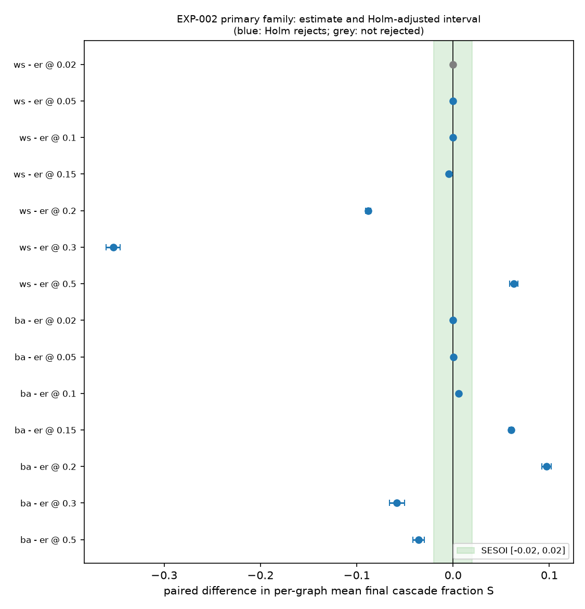
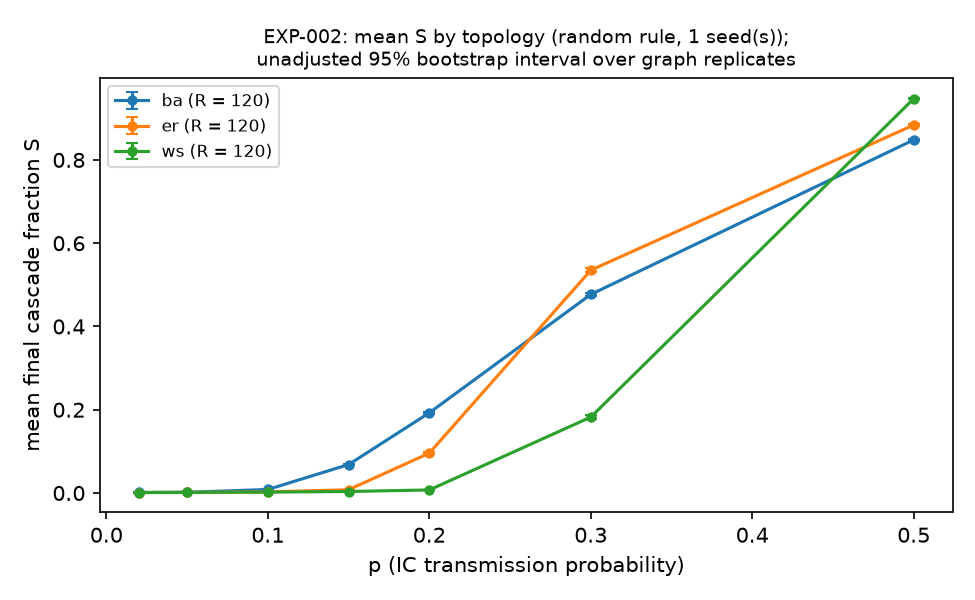

<!-- SPDX-License-Identifier: LicenseRef-VIRAL-NC-Research-1.0 -->
# EXP-002 report: independent cascade, topology x transmission x initial exposure

## 1. Identification

- Experiment: EXP-002 (primary, confirmatory). Report version 1.1, 2026-11-25 (M4: evidence-audit corrections and addendum; version 1.0 of the same date was the M3 report). Status: **complete. The full frozen matrix ran, with no failed or dropped run.**
- Authorship: Mohamed Bechir Kefi (no affiliation). An AI research and development assistant (Claude, Anthropic) ran the experiment and drafted this report under the owner's direction; it is not an author.
- Study protocol `research/protocol.md` v1.0, SHA-256 `d984f2f8f2fba8f5ddabe097b0a82be8d17ab652422769f9c22cc442f1a17b32`. Experiment protocol v1.0, SHA-256 `2b21902acfdedd2acb9395633e2ae28ddffb3f8dba1927e8f2a05cd0fd58272c`. Both are in `research/freeze.json`, owner-approved 2026-11-24.
- Provenance revision `32961c3c399263ff3e39a9dbd3f78be3ff934922`. The tree was clean at run time (`git_dirty: false`).
- Written after the run from committed result files only, with the owner's approval of 2026-11-25 (D-013). No number was recomputed.
- Every result is a **simulation** of a stylised model on synthetic graphs. Nothing here describes a real platform or its algorithms.

## 2. Executive summary

- **Question.** Hold fixed the node count (1000), the mean degree (6) and the transmission probability `p`. Does the expected final cascade fraction `S` of the independent cascade (IC) model then differ between Watts-Strogatz (WS) or Barabasi-Albert (BA) graphs and Erdos-Renyi (ER) graphs?
- **Method.** 120 matched graph replicates per topology and 200 cascades per graph and setting, over 7 values of `p`. The primary analysis uses one uniformly random seed: 14 paired per-`p` contrasts in one Holm family, with the frozen interval method of protocol section 11.3.
- **Outcome.** Holm rejects H0 for 13 of 14 contrasts.
  - The only non-rejection is WS minus ER at `p = 0.02`, and its interval lies inside the smallest effect size of interest (SESOI, [-0.02, 0.02]).
  - Seven contrasts have intervals entirely outside the SESOI: WS minus ER at `p` = 0.20 (-0.0884), 0.30 (-0.3529) and 0.50 (+0.0632), and BA minus ER at `p` = 0.15 (+0.0604), 0.20 (+0.0969), 0.30 (-0.0583) and 0.50 (-0.0358).
  - The other seven intervals lie inside the SESOI. Six of them are rejected: detectable but negligible.
- **Principal caveat.** Both effects change sign with `p`, so no single "topology effect" exists. In EXP-004, a degree-preserving null (S2) matches the BA advantage at `p` = 0.15 and 0.20, so that advantage is carried by the degree sequence.

## 3. Rationale and literature

On locally tree-like graphs, IC final size is related to bond percolation, and the threshold estimate used in this study, `p_c = <k>/(<k^2> - <k>)`, depends on the first two degree moments. The abstract of Newman, Strogatz and Watts (2001; abstract read) states that the giant-component transition of random graphs is derived for arbitrary degree distributions, and the abstract of Pastor-Satorras and Vespignani (2001; abstract read) reports the absence of an epidemic threshold on scale-free networks. The expression itself was not checked against either paper's full text (evidence audit, M4). WS graphs add clustering and short paths (Watts and Strogatz 1998; metadata only, text not read), and BA graphs add hubs (Barabasi and Albert 1999; abstract read). Verification levels are in `research/literature_review.md`.

The gap addressed is a small, fully reproducible, matched comparison with replicate-level uncertainty and a pre-registered sensitivity programme (EXP-004). This is a replication-and-integration study, not a novelty claim.

## 4. Hypotheses and operational definitions

- `S = |A_final| / N`: the fraction of nodes ever activated, in [0, 1].
- `Sbar_{T,r}(p)`: the mean of `S` over the 200 cascades on replicate `r` of topology `T` at `p`, with one uniformly random seed.
- Estimand: `Delta_T(p) = E_r[ Sbar_{T,r}(p) - Sbar_{ER,r}(p) ]` for `T` in {WS, BA} and `p` in {0.02, 0.05, 0.10, 0.15, 0.20, 0.30, 0.50}.
- For each `(T, p)`: H0 `Delta_T(p) = 0` and H1 `Delta_T(p) != 0`. The 14 tests form one Holm family at familywise level 0.05.
- Disconfirmation: H1 is not supported for `(T, p)` if Holm does not reject it. Equivalence is claimed only if the reported interval lies entirely inside `[-0.02, 0.02]`.
- Directional expectation, recorded but not tested: BA above ER at small `p`, with a possible crossing at large `p`.

## 5. Methodology

- **Graphs.** ER `G(n, M)` with `M = 3000`; WS ring lattice with `k = 6` and `beta = 0.1`; BA with `m = 3` (2991 edges). Means over the 120 replicates, from `tables/graphs.csv`:

| statistic | ER | WS | BA |
|---|---|---|---|
| `<k^2>` | 41.96 | 36.57 | 84.53 |
| `p_c = <k>/(<k^2> - <k>)` | 0.1669 | 0.1963 | 0.0765 |
| average clustering | 0.0060 | 0.4428 | 0.0307 |
| giant-component fraction | 0.9975 | 1 | 1 |

- **Engine.** Synchronous IC, vectorised implementation, exactly differential-tested against the reference loop (M2).
- **Matrix.** Topology (3) x `p` (7) x seed rule {random, highest degree} x seed count {1, 10} = 84 cells. With `R = 120` and `C = 200`, that is 2,016,000 cascades.
- **Seeds.** Master seed 20261125. Graph and cascade streams come from `numpy.random.SeedSequence`. Replicates with the same index share cascade streams across topologies (common random numbers).
- **Statistics.**
  - Per-`p` paired differences over 120 matched sets.
  - One `10000 x 120` bootstrap index matrix, drawn from `SeedSequence(20261125, spawn_key=(2,))`.
  - Two-sided bootstrap p-values and Holm step-down.
  - Percentile interval at level `1 - 0.05/(m - i)` up to the first non-rejection, and at `1 - 0.05/(m - j*)` after it (protocol 11.3).
  - Code: `viral.confirmatory.per_param_family`, which calls `viral.stats.holm_bootstrap_contrasts`.
- **Hardware and software.** Apple M1 Pro (10 logical CPUs), macOS 15.3.1, Python 3.12.1, numpy 2.5.4, networkx 3.7. Budget 4 hours; runtime 1047.8 s.

## 6. Implementation verification

- The test suite passed 174 tests before the confirmatory runs (`progress.md`). This includes the engine differential tests, invariants, determinism, and `tests/test_confirmatory.py`, which checks that the confirmatory analysis exactly reproduces `viral.analysis.confirmatory_contrasts`.
- Exploratory smoke run `EXP-001-20261124T233106Z-99c548ac` (pilot seed 20261124, disjoint from every confirmatory seed): 15 graphs, 5,250 cascades, 0 verification failures. Exploratory metric validation: 54 checks, 0 failures.
- In the confirmatory run, 360 graphs were checked against the 1 percent mean-degree tolerance, with 0 failures. Per-cascade verification is off in the frozen config (`verify: false`).
- The analysis code was committed (`32961c3`) before any confirmatory output existed and was not changed afterwards.

## 7. Execution record

- Command: `nice -n 10 .venv/bin/viral run --config experiments/EXP-002/config.json --out results/raw/confirmatory/EXP-002`.
- Config file SHA-256 `3a1cd795beb86e3f132f56cacb4b3ff63a08bc94848c27a5bba616cee9954ac8`, accepted by the freeze guard. Canonical config hash `2c7febb68d111345c89d9d165dc574b107319b8b3dd4df141b4de66db64f4256`.
- Run `EXP-002-20261124T233447Z-2c7febb6`: started 2026-11-24T23:34:47Z and finished 2026-11-24T23:52:15Z (UTC). Runtime 1047.8 s, peak RSS 230,555,648 bytes, exit status 0.
- Counts: 360 graphs, 10,080 cells and 2,016,000 cascades, the complete frozen matrix. No run was dropped, failed or retried.
- Deviations from the frozen protocol: none in design or analysis.
  - Storage: the raw `result.json` (100 MB) is in the git-ignored `results/raw/confirmatory/`, with its SHA-256 committed (D-012; freeze record M3-1).
  - Item 20 of the protocol names `viral report`. In practice, the frozen inferential analysis is produced by `scripts/analyse_confirmatory.py`, and `viral report` produces the descriptive tables (D-012).
- Owner decision affecting the reading: EXP-004 S1 is reported per multiplier, with no overall verdict (owner, 2026-11-25, "approve all recommendations, RIGGED A"; D-013).

## 8. Results

### 8.1 Primary family (14 tests, Holm, protocol 11.3 intervals)

Source: `results/confirmatory/EXP-002/EXP-002-20261124T233447Z-2c7febb6/primary_contrasts.csv`, also copied to `metrics.csv`; claims `EXP-002-R01` to `EXP-002-R14`. Each contrast uses 120 independent matched sets. Bootstrap p-values have resolution 1e-4, and 0 is reported as `< 1e-4`.

| contrast | p | mean diff | interval | level | Holm p | H0 rejected | inside SESOI |
|---|---|---|---|---|---|---|---|
| WS - ER | 0.02 | -1.17e-06 | [-3.37e-06, +9.58e-07] | 0.9500 | 0.2972 | no | yes |
| WS - ER | 0.05 | -3.27e-05 | [-4.01e-05, -2.59e-05] | 0.9929 | < 1e-4 | yes | yes |
| WS - ER | 0.10 | -0.0004 | [-0.0004, -0.0003] | 0.9917 | < 1e-4 | yes | yes |
| WS - ER | 0.15 | -0.0043 | [-0.0046, -0.0041] | 0.9900 | < 1e-4 | yes | yes |
| WS - ER | 0.20 | -0.0884 | [-0.0910, -0.0857] | 0.9875 | < 1e-4 | yes | no |
| WS - ER | 0.30 | -0.3529 | [-0.3601, -0.3456] | 0.9833 | < 1e-4 | yes | no |
| WS - ER | 0.50 | +0.0632 | [+0.0589, +0.0676] | 0.9750 | < 1e-4 | yes | no |
| BA - ER | 0.02 | +0.0000 | [+0.0000, +0.0000] | 0.9964 | < 1e-4 | yes | yes |
| BA - ER | 0.05 | +0.0003 | [+0.0002, +0.0003] | 0.9962 | < 1e-4 | yes | yes |
| BA - ER | 0.10 | +0.0059 | [+0.0056, +0.0063] | 0.9958 | < 1e-4 | yes | yes |
| BA - ER | 0.15 | +0.0604 | [+0.0583, +0.0624] | 0.9955 | < 1e-4 | yes | no |
| BA - ER | 0.20 | +0.0969 | [+0.0921, +0.1018] | 0.9950 | < 1e-4 | yes | no |
| BA - ER | 0.30 | -0.0583 | [-0.0659, -0.0503] | 0.9944 | < 1e-4 | yes | no |
| BA - ER | 0.50 | -0.0358 | [-0.0416, -0.0297] | 0.9938 | < 1e-4 | yes | no |

The BA - ER values at `p = 0.02` round to zero at four decimals. Full precision is in the CSV and in claim `EXP-002-R08`.

### 8.2 Absolute levels (descriptive)

Mean over 120 replicates of per-graph mean `S`, with one random seed. Unadjusted 95 percent intervals over replicates are in `topology_means.csv`.

| p | ER | WS | BA |
|---|---|---|---|
| 0.02 | 0.0011 | 0.0011 | 0.0012 |
| 0.05 | 0.0014 | 0.0014 | 0.0017 |
| 0.10 | 0.0025 | 0.0021 | 0.0084 |
| 0.15 | 0.0079 | 0.0036 | 0.0683 |
| 0.20 | 0.0957 | 0.0073 | 0.1926 |
| 0.30 | 0.5352 | 0.1823 | 0.4769 |
| 0.50 | 0.8839 | 0.9471 | 0.8481 |

### 8.3 Secondary estimates (unadjusted, labelled secondary)

Source: `secondary_contrasts.csv`. These are 95 percent percentile intervals, not adjusted, from the stream `SeedSequence(20261125, spawn_key=(2, 1))`.

- **Grid-mean contrast** (the secondary estimand of protocol 11.1), random single seed: WS - ER -0.0547 [-0.0557, -0.0536]; BA - ER +0.0099 [+0.0087, +0.0112]. The grid mean hides the sign changes of section 8.1 and is not used for any decision.
- **Grid means in the other exposure conditions:**

| exposure | WS - ER | BA - ER |
|---|---|---|
| highest-degree, single seed | -0.0905 [-0.0915, -0.0895] | +0.0707 [+0.0699, +0.0714] |
| highest-degree, ten seeds | -0.0794 [-0.0799, -0.0788] | +0.0451 [+0.0447, +0.0455] |
| ten random seeds | -0.0740 [-0.0746, -0.0735] | +0.0421 [+0.0418, +0.0425] |

- **Per `p`, other exposures.** With the highest-degree single seed, BA - ER is +0.2283 [+0.2268, +0.2298] at `p = 0.15` and +0.2474 [+0.2441, +0.2507] at `p = 0.20`. With ten random seeds, BA - ER is +0.1897 [+0.1884, +0.1911] at `p = 0.15`. The WS deficit at `p` 0.20 to 0.30 appears in every exposure condition, ranging from -0.1767 to -0.4681. Depth, T50, Gini and large-cascade-share contrasts are in the same CSV.
- **Variance decomposition** (`tables/variance.csv`). In the random single-seed cells, variation between cascades on the same graph dominates. For example, its share of the variance of `S` at `p = 0.02` is 0.9948.

### 8.4 Figures

*Figure EXP-002-F1. Paired difference in per-graph mean `S` (treatment minus ER) at each `p`, with the Holm-step percentile interval of protocol 11.3 (levels 0.95 to 0.9964, as in the table). Blue: Holm rejects; grey: not rejected. Green band: SESOI [-0.02, 0.02]. R = 120 matched sets per contrast. Several intervals are narrower than the markers.*

*Figure EXP-002-F2. Mean over 120 replicates of per-graph mean `S` by `p` and topology (IC, one random seed), with unadjusted 95 percent percentile bootstrap intervals over replicates. Most intervals are narrower than the markers. Lines join measured grid points only.*

## 9. Interpretation

- **Expected versus observed.**
  - BA had a recorded expectation: above ER at small `p`, possibly reversing at large `p`. Observed: BA is above ER from `p = 0.02` to 0.20 (by more than 0.02 only at 0.15 and 0.20) and below it at 0.30 and 0.50. The expected crossing occurred.
  - WS had no directional expectation. It is below ER from 0.05 to 0.30 and above it at 0.50.
- **Verdict under the frozen rule.** H1 is supported for 13 of 14 `(T, p)`.
  - For WS - ER at `p = 0.02`, H1 is not supported. Its interval lies inside the SESOI, so equivalence within 0.02 is supported there.
  - Of the supported effects, six have intervals inside the SESOI (negligible) and seven exceed it.
- **Model-dependent reading.** These are explanations within the model, not tested mechanisms.
  - BA: the pattern matches the percolation account. BA's lower threshold estimate (0.0765, against 0.1669 for ER) lets cascades take off at smaller `p`.
  - WS: the deficit near threshold is consistent with its higher threshold estimate (0.1963) and strong clustering (0.4428).
- **Competing explanations (EXP-004).**
  - Edge-count mismatch (S3) and finite size (S4, optional, `N` = 500 and 2000) do not remove the pattern. Each gives 13 of 14 rejections with the same signs.
  - Degree sequence (S2): the degree-preserving null has intervals inside the SESOI for `p` 0.02 to 0.20. The BA advantage at 0.15 and 0.20 is therefore a degree-sequence effect (EXP-004 protocol item 6). At 0.30 and 0.50, S2 is rejected.
  - Threshold rescaling (S1) is reported per multiplier with no overall verdict (owner decision, D-013), so it reclassifies no EXP-002 effect.
- **Literature.** The results are consistent with the cited percolation results. The experiment replicates rather than extends them.

## 10. Threats to validity

- **Internal.** Matched sets share random streams, but node labels are not exchangeable across topologies (protocol section 9). Random seeding draws node indices uniformly, as frozen.
- **Construct.** Content quality is held fixed through one shared `p`. It is not modelled.
- **External.** The study covers one size (`N = 1000`, with S4 at 500 and 2000), one mean degree, one WS `beta` and one BA `m`. It does not generalise to other graph families, to real networks (EXP-005 tests one) or to any platform.
- **Statistical.**
  - With `R = 120` and common random numbers, differences far below the SESOI are rejected, so every rejection must be read with the SESOI column.
  - Bootstrap p-values have resolution 1e-4.
  - Pilot values at `R = 10` were seen before the freeze (disclosed in `research/freeze.json`, C4). The confirmatory run used a new master seed and the frozen analysis.

## 11. Conclusion and next experiment

Within this simulation, topology changes the expected IC final cascade fraction in 13 of 14 tested conditions, at matched size, density and transmission probability.
- The largest difference is WS minus ER at `p = 0.30`: -0.3529 [-0.3601, -0.3456].
- The direction depends on `p`.
- The BA advantage near threshold is carried by the degree sequence (S2).

Next: M4 interpretation, a second review pass that challenges the preferred reading, and the manuscript.

## 12. Reproduction appendix

See `reproduction.md`.
- Raw result: `results/raw/confirmatory/EXP-002/EXP-002-20261124T233447Z-2c7febb6/result.json` (git-ignored), SHA-256 `f6b8e03e0697e228988f01ff7130a0c9c8cafcc86fac26b43a8dac071a44af94`, result schema 1.1.0.
- Committed outputs: `results/confirmatory/EXP-002/EXP-002-20261124T233447Z-2c7febb6/` and `results/confirmatory/MANIFEST.sha256`.
- References: `research/literature_review.md` and `research/paper/references.bib`.

## Addendum (M4, 2026-11-25): competing explanations and an exploratory check

**This addendum does not change the frozen verdict of section 9.**

- **Competing explanations named in the protocol (item 4) and what addresses them.**
  - (a) Degree heterogeneity alone. S2 addresses it for BA: the BA advantage at `p` 0.15 and 0.20 is a degree-sequence effect. S1 gives no overall verdict (D-013). For WS no confirmatory analysis addresses it.
  - (b) Edge-count mismatch. S3 rules it out.
  - (c) Finite size. S4 rules it out for `N` from 500 to 2000 only.
  - (d) Cascade-level noise. Replicate-level inference addresses it.
- **Exploratory check X1 (post hoc, `scripts/exploratory_m4.py`, master seed 20261201, R = 30, unadjusted 95 percent intervals).**
  - The check adds a degree-preserving randomisation of every WS graph (`ws_dpr`). It keeps the WS degree sequence and removes its clustering: average clustering 0.0043 against 0.4410 for WS on the same seeds.
  - On fresh seeds, WS - ER at `p = 0.30` is -0.3524 [-0.3619, -0.3426], close to the confirmatory -0.3529.
  - Nearly all of that difference is structure beyond the degree sequence: WS - ws_dpr is -0.3662 [-0.3750, -0.3573], while ws_dpr - ER is +0.0137 [+0.0030, +0.0246].
  - At `p = 0.20`, both parts contribute: WS - ws_dpr -0.0212 [-0.0224, -0.0199] and ws_dpr - ER -0.0699 [-0.0742, -0.0657].
  - At `p = 0.50`, the WS advantage goes with its degree sequence: ws_dpr - ER is +0.0709 [+0.0634, +0.0779].
  - The randomisation removes clustering and ring order together, so it cannot separate them.
  - Rows: `results/exploratory/M4/m4_exploratory_contrasts.csv`; claims M4-X1-01 to M4-X1-21.
- **Evidence audit.** The literature sentence of section 3 now states the verification level of each source. Every number in this report was traced to a committed file, and the frozen analysis was recomputed from the raw result with no difference (`research/publication/evidence_audit.md`).
