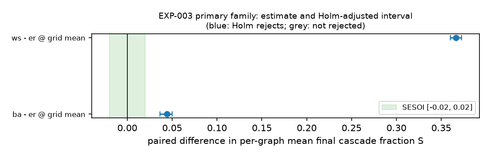
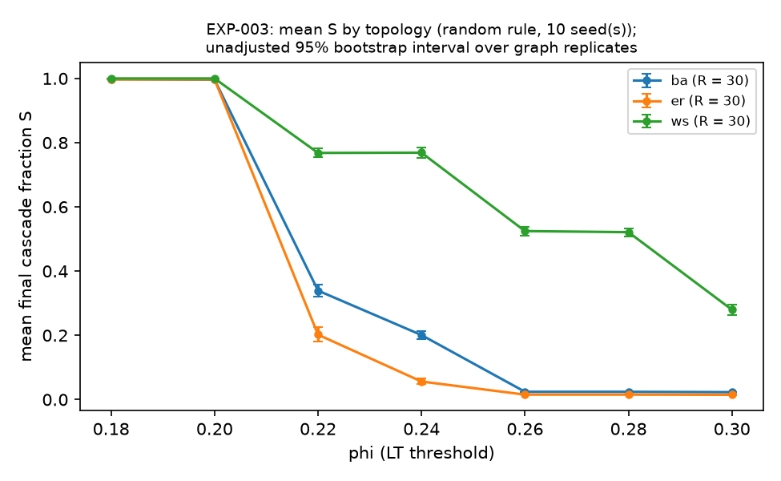

<!-- SPDX-License-Identifier: LicenseRef-VIRAL-NC-Research-1.0 -->
# EXP-003 report: fractional-threshold diffusion, topology x threshold x initial exposure

## 1. Identification

- Experiment: EXP-003 (secondary, confirmatory). Report version 1.0, 2026-11-25. Status: **complete. The full frozen matrix ran, with no failed or dropped run.**
- Authorship: Mohamed Bechir Kefi (no affiliation). An AI research and development assistant (Claude, Anthropic) ran the experiment and drafted this report under the owner's direction; it is not an author.
- Experiment protocol v1.0, SHA-256 `55ed5cb330f1fafc2f764949375fb6c8b070ceef007172ecb66641fcdd8280ac`. Study protocol SHA-256 `d984f2f8f2fba8f5ddabe097b0a82be8d17ab652422769f9c22cc442f1a17b32` (`research/freeze.json`).
- Provenance revision `32961c3c399263ff3e39a9dbd3f78be3ff934922`, clean tree.
- Written from committed result files only, with the owner's approval of 2026-11-25 (D-013).
- Simulation only.

## 2. Executive summary

- **Question.** Under a fractional-threshold (LT) model, does the final cascade fraction differ between WS or BA and ER graphs at matched size and mean degree?
- **Method.** `R = 30` replicates per topology and `C = 200` seed sets per graph and setting, over the threshold grid `phi` in {0.18, 0.20, ..., 0.30}. Primary analysis: the grid mean of `S` with 10 random seeds, giving 2 contrasts in one Holm family.
- **Outcome.** Both contrasts are rejected, and both intervals lie outside the SESOI:
  - WS - ER +0.3664 [+0.3602, +0.3727]
  - BA - ER +0.0439 [+0.0366, +0.0498]
- **Caveat.** The grid mean mixes saturated thresholds (0.18, 0.20) with the transition region (0.22 to 0.30). Under LT, WS ranks above ER, the opposite of its IC deficit near threshold in EXP-002.

## 3. Rationale

Threshold (complex) contagion needs several exposures. Hubs are hard to activate, and clustering supplies redundant exposure (Granovetter 1978; Watts 2002; Centola and Macy 2007; verification levels in `research/literature_review.md`). The experiment tests whether the EXP-002 ordering depends on the contagion model.

## 4. Hypotheses and definitions

- `Sbar_{T,r}`: the mean over the `phi` grid of per-graph mean `S` (LT, random rule, 10 seeds).
- H0: `Delta^LT_WS = 0` and `Delta^LT_BA = 0`. H1: at least one differs (nondirectional).
- Holm over 2 contrasts, with protocol 11.3 intervals. Equivalence only inside `[-0.02, 0.02]`.
- Depth follows the frozen planning definition, under which `D = T` for every LT cascade (disclosed, D-007 A4).

## 5. Methodology

- Graphs as in EXP-002, with `N = 1000` and `<k> = 6`. Means over the 30 replicates (`tables/graphs.csv`):

| statistic | ER | WS | BA |
|---|---|---|---|
| `<k^2>` | 41.92 | 36.56 | 84.06 |
| average clustering | 0.0059 | 0.4467 | 0.0308 |

- Matrix: 3 topologies x 7 `phi` x seed rule {random, highest degree} x seed count {1, 10}. With `R = 30` and `C = 200`, that is 504,000 cascades.
- For the highest-degree rule, the 200 draws differ only through the seeded tie-break (amendment implementation note).
- Master seed 20261126. Bootstrap stream `SeedSequence(20261126, spawn_key=(2,))`, `B = 10000`.
- Code: `viral.confirmatory.grid_mean_family`.
- Hardware and software as in EXP-002. Budget 1 hour; runtime 502.4 s.

## 6. Implementation verification

The suite passed 174 tests before the run, and the exploratory checks passed (EXP-001 report). The LT reference and vectorised engines are exactly differential-tested. In this run, 90 graphs were checked with 0 failures. The analysis code was committed before the run.

## 7. Execution record

- Command: `nice -n 10 .venv/bin/viral run --config experiments/EXP-003/config.json --out results/raw/confirmatory/EXP-003`.
- Config file SHA-256 `728f9a31435777ffce283aa282ab8ee1c45eb5ef93b0bf865ff12012a4a6b659`. Canonical hash `a2d668abb8f1dd40c442582d4276509c81040a95a47f2d00277abdc9f47a2abd`.
- Run `EXP-003-20261124T234212Z-a2d668ab`: 2026-11-24T23:42:12Z to 23:50:34Z (UTC). Runtime 502.4 s, peak RSS 97,435,648 bytes, exit status 0.
- Counts: 90 graphs, 2,520 cells and 504,000 cascades, the complete matrix. No run was dropped, failed or retried.
- Deviations: none in design or analysis. The raw result (23 MB) is git-ignored with its SHA-256 committed (D-012).

## 8. Results

### 8.1 Primary family (Holm over 2)

Source: `results/confirmatory/EXP-003/EXP-003-20261124T234212Z-a2d668ab/primary_contrasts.csv`; claims `EXP-003-R01` and `EXP-003-R02`. Each contrast uses 30 independent matched sets.

| contrast | grid mean diff | interval | level | Holm p | H0 rejected | inside SESOI |
|---|---|---|---|---|---|---|
| WS - ER | +0.3664 | [+0.3602, +0.3727] | 0.950 | < 1e-4 | yes | no |
| BA - ER | +0.0439 | [+0.0366, +0.0498] | 0.975 | < 1e-4 | yes | no |

The sd of the paired differences was 0.0179 (WS - ER) and 0.0164 (BA - ER).

### 8.2 Levels and per-`phi` contrasts (descriptive and secondary, unadjusted)

Mean `S` with 10 random seeds (`topology_means.csv`), and per-`phi` contrasts with unadjusted 95 percent intervals (`secondary_contrasts.csv`):

| phi | ER | WS | BA | WS - ER | BA - ER |
|---|---|---|---|---|---|
| 0.18 | 0.9970 | 1.0000 | 0.9978 | +0.0030 [+0.0022, +0.0038] | +0.0007 [-0.0011, +0.0024] |
| 0.20 | 0.9970 | 1.0000 | 0.9962 | +0.0030 [+0.0022, +0.0038] | -0.0009 [-0.0029, +0.0010] |
| 0.22 | 0.2020 | 0.7681 | 0.3392 | +0.5661 [+0.5389, +0.5932] | +0.1372 [+0.1059, +0.1654] |
| 0.24 | 0.0561 | 0.7688 | 0.2008 | +0.7127 [+0.6922, +0.7321] | +0.1447 [+0.1291, +0.1585] |
| 0.26 | 0.0153 | 0.5247 | 0.0241 | +0.5094 [+0.4958, +0.5232] | +0.0088 [+0.0085, +0.0092] |
| 0.28 | 0.0153 | 0.5212 | 0.0241 | +0.5059 [+0.4934, +0.5184] | +0.0088 [+0.0084, +0.0092] |
| 0.30 | 0.0148 | 0.2797 | 0.0230 | +0.2649 [+0.2487, +0.2804] | +0.0082 [+0.0080, +0.0085] |

Grid means in the other exposure conditions (secondary, unadjusted):

| exposure | WS - ER | BA - ER |
|---|---|---|
| random, single seed | +0.1233 [+0.1150, +0.1316] | -0.0083 [-0.0185, +0.0021] |
| highest-degree, single seed | +0.0459 [+0.0045, +0.0887] | +0.3374 [+0.2917, +0.3854] |
| highest-degree, ten seeds | +0.2718 [+0.2456, +0.2963] | +0.4253 [+0.4208, +0.4305] |

### 8.3 Figures

*Figure EXP-003-F1. Grid-mean paired difference in per-graph mean `S` (treatment minus ER), LT, 10 random seeds, R = 30, with Holm-step percentile intervals (levels 0.95 and 0.975). Green band: SESOI [-0.02, 0.02].*

*Figure EXP-003-F2. Mean over 30 replicates of per-graph mean `S` by `phi` and topology (10 random seeds), with unadjusted 95 percent bootstrap intervals over replicates.*

## 9. Interpretation

- **Verdict under the frozen rule.** H1 is supported for both contrasts, and both exceed the SESOI.
- **Expected versus observed.** The protocol expected that the topology ordering "may differ from IC", without a direction.
  - WS: under LT it lies far above ER, while under IC it lies below ER near threshold (EXP-002). The ordering of WS against ER does depend on the contagion model.
  - BA: it is above ER under both models on the respective grid means.
- **Model-dependent reading.** This is consistent with the complex-contagion account, in which clustering supplies the repeated exposures that thresholds require. It is not a tested mechanism.
- **Negative and flat cells.**
  - At `phi` 0.18 and 0.20 all topologies saturate, and the BA - ER intervals include 0.
  - Values at 0.26 and 0.28 are nearly identical.
  - The grid-mean result is therefore driven by `phi` 0.22 to 0.30 (limitation 15).
  - With a single random seed, BA - ER is not distinguishable from 0 in the secondary estimate.

## 10. Threats to validity

The grid mixes saturated and transition thresholds, so the grid mean depends on the grid chosen (amended before the freeze, after pilot exposure on the old grid; C4). `D` equals `T` by construction. With `R = 30`, intervals are wider than in EXP-002. The study covers one WS `beta` and one BA `m`, in simulation only.

## 11. Conclusion

Under fractional-threshold diffusion with ten random seeds, WS graphs reach far larger final cascades than ER on the frozen grid mean: +0.3664 [+0.3602, +0.3727]. BA graphs reach modestly larger ones: +0.0439 [+0.0366, +0.0498]. Next: M4, which compares this with EXP-002 in the manuscript.

## 12. Reproduction appendix

See `reproduction.md`. Raw result SHA-256 `3f9b6c0b74a86c3f08c5d0538dd93e4b3cc30c5b57aceec4808a92a82e1a5778`. Committed outputs are in `results/confirmatory/EXP-003/EXP-003-20261124T234212Z-a2d668ab/`.
