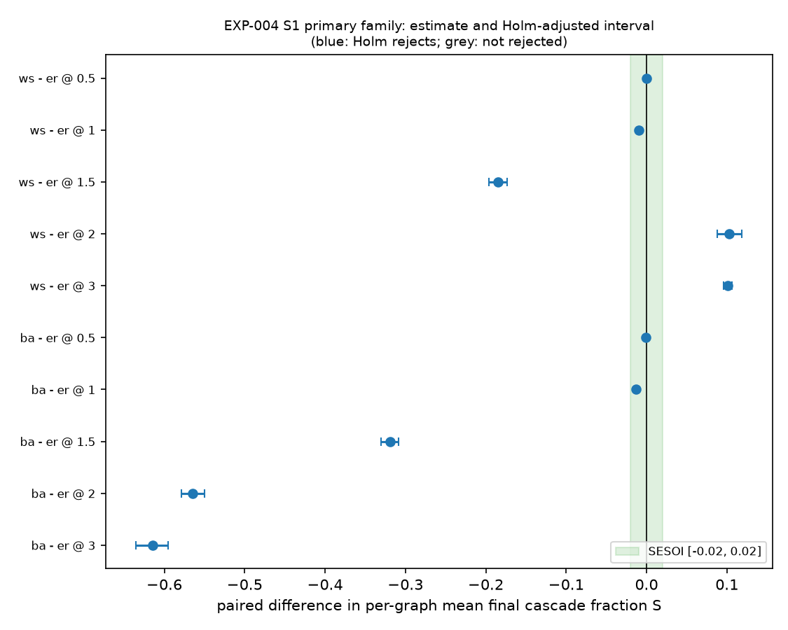
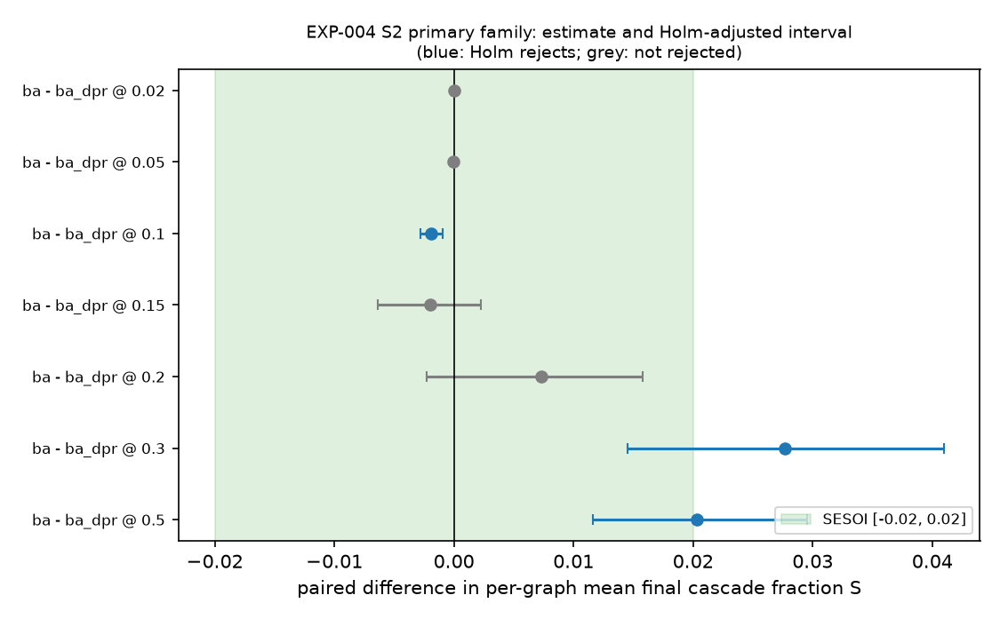

<!-- SPDX-License-Identifier: LicenseRef-VIRAL-NC-Research-1.0 -->
# EXP-004 report: sensitivity analyses S1 to S4 for EXP-002

## 1. Identification

- Experiment: EXP-004 (confirmatory sensitivity analyses; S4 optional). Report version 1.1, 2026-11-25 (M4: evidence-audit corrections and addendum; version 1.0 of the same date was the M3 report). Status: **complete. Five runs (S1, S2, S3, S4 at N = 500 and N = 2000), none failed or dropped.**
- Authorship: Mohamed Bechir Kefi (no affiliation). An AI research and development assistant (Claude, Anthropic) ran the analyses and drafted this report under the owner's direction; it is not an author.
- Experiment protocol v1.0, SHA-256 `bc3746ae7ac7f1eb6b65dbe502ad3fb3d50ec45869a893689f5c9b734e959a44`. Study protocol SHA-256 `d984f2f8f2fba8f5ddabe097b0a82be8d17ab652422769f9c22cc442f1a17b32`.
- Provenance revision `32961c3c399263ff3e39a9dbd3f78be3ff934922`, clean tree.
- Written from committed files only, with the owner's approval of 2026-11-25 (D-013).
- Simulation only.

## 2. Executive summary

- **Question.** Is the EXP-002 topology difference explained by the degree moments (S1, S2), by the residual edge-count mismatch (S3) or by finite size (S4)?
- **Outcome.**
  - **S1 (threshold rescaling, `p = c p_c(G)`):** 10 of 10 rejected. Intervals lie inside the SESOI at c = 0.5 and 1 and outside at c = 1.5, 2 and 3. By the owner's decision of 2026-11-25 (D-013), S1 is reported per multiplier, with no overall verdict.
  - **S2 (BA minus degree-preserving randomised BA):** 3 of 7 rejected. Intervals lie inside the SESOI for `p` 0.02 to 0.20.
  - **S3 (exact edge matching):** 13 of 14 rejected, the same pattern as EXP-002.
  - **S4 (optional):** 13 of 14 rejected at both N = 500 and N = 2000, the same pattern.
- **Caveat.** S1 cannot reclassify EXP-002 effects as a whole: the frozen texts do not define which multipliers correspond to each `p`, and the owner decided against an overall verdict.

## 3. Rationale

Under the locally tree-like approximation, the IC threshold estimate is `p_c = <k>/(<k^2> - <k>)`. BA has a larger `<k^2>` than ER at the same `<k>` (measured: `tables/graphs.csv`). The cited sources (Newman, Strogatz and Watts 2001; Pastor-Satorras et al. 2015) were read at abstract level only, and the expression was not checked against their full text (evidence audit, M4). The analyses were fixed before any result.

## 4. Hypotheses and decision rules

- Each analysis is a per-parameter family of paired contrasts with Holm inside the analysis and protocol 11.3 intervals:
  - S1: 10 tests (WS - ER and BA - ER at c in {0.5, 1, 1.5, 2, 3}).
  - S2: 7 tests (BA - ba_dpr per `p`).
  - S3: 14 tests (ws_trim - er_trim and BA - er_trim per `p`).
  - S4: 14 tests per size.
- Item 6: if S1 or S2 shows no difference while EXP-002 shows one, the effect is a degree-sequence effect.
- S1 criterion (per-multiplier reading, ratified D-011): the S1 Holm interval at a multiplier must lie inside `[-0.02, 0.02]`.
- Owner decision of 2026-11-25 (D-013), quoted: "S1 is reported separately for each multiplier, consistent with the round-3 ratified per-multiplier criterion." "S1 gets no single overall verdict, and no multiplier is picked after the data."

## 5. Methodology

- Master seed 20261125, the EXP-002 seed. All runs use `R = 30`, `C = 200`, one random seed, and bootstrap stream `SeedSequence(20261125, spawn_key=(2,))`, `B = 10000`.
- The S1 to S3 graphs were checked to be identical to EXP-002 replicates 0 to 29, by networkx seed and degree second moment: 210 of 210 graphs (`progress.md`).
- S2: `ba_dpr` is BA replicate `r` after `10 M` seeded double-edge swaps. It keeps the degree sequence (`<k^2>` 85.28 for both) and has clustering 0.0286 against 0.0308 for BA (`tables/graphs.csv`).
- S3: ER and WS are trimmed to 2991 edges.
- S4: N = 500 and N = 2000.
- Code: `viral.confirmatory.per_param_family`.
- Hardware as in EXP-002. Budget 3 hours; total runtime 351.1 s over the five runs (104.3, 73.8, 90.2, 22.9 and 60.0 s; the sum of the unrounded run times, corrected at M4: version 1.0 printed the sum of the rounded values, one tenth of a second higher).

## 6. Implementation verification

The suite passed 174 tests before the runs. All 450 graphs across the five runs were checked against the tolerance, with 0 failures. The analysis code was committed before the runs.

## 7. Execution record

| analysis | run id | config file SHA-256 (prefix) | start to finish (UTC) | runtime | graphs / cascades | exit |
|---|---|---|---|---|---|---|
| S1 | EXP-004-20261124T233447Z-de14a4b3 | 17f64abe4ef7 | 23:34:47 to 23:36:31 | 104.3 s | 90 / 90,000 | 0 |
| S2 | EXP-004-20261124T233637Z-916e8d29 | 42fd53afd45e | 23:36:37 to 23:37:50 | 73.8 s | 60 / 84,000 | 0 |
| S3 | EXP-004-20261124T233755Z-e1d24091 | 9d0aaf2b4e76 | 23:37:55 to 23:39:25 | 90.2 s | 90 / 126,000 | 0 |
| S4 N = 500 (optional) | EXP-004-20261124T235044Z-e31dba07 | 6e91910ff329 | 23:50:44 to 23:51:07 | 22.9 s | 90 / 126,000 | 0 |
| S4 N = 2000 (optional) | EXP-004-20261124T235110Z-40385ec3 | b9cf372f65aa | 23:51:10 to 23:52:10 | 60.0 s | 90 / 126,000 | 0 |

All dates are 2026-11-24 (UTC). The complete frozen matrices ran, with no retry. Deviations: none in design or analysis. Raw results (28 MB in total) are git-ignored with their SHA-256 committed (D-012). The S1 reading follows the owner's decision (D-013; freeze record M3-2).

## 8. Results

All values come from the `primary_contrasts.csv` file of each analysis under `results/confirmatory/EXP-004/` (also copied as `S*-metrics.csv`). Each contrast uses 30 independent matched sets, and `< 1e-4` marks a Holm p of 0.

### 8.1 S1, threshold rescaling (Holm over 10), reported per multiplier

| contrast | c | mean diff | interval | level | Holm p | rejected | inside SESOI |
|---|---|---|---|---|---|---|---|
| WS - ER | 0.5 | +0.0001 | [+0.0000, +0.0001] | 0.9900 | < 1e-4 | yes | yes |
| WS - ER | 1 | -0.0100 | [-0.0110, -0.0089] | 0.9875 | < 1e-4 | yes | yes |
| WS - ER | 1.5 | -0.1847 | [-0.1960, -0.1731] | 0.9833 | < 1e-4 | yes | no |
| WS - ER | 2 | +0.1032 | [+0.0883, +0.1187] | 0.9750 | < 1e-4 | yes | no |
| WS - ER | 3 | +0.1014 | [+0.0960, +0.1065] | 0.9500 | < 1e-4 | yes | no |
| BA - ER | 0.5 | -0.0006 | [-0.0006, -0.0005] | 0.9950 | < 1e-4 | yes | yes |
| BA - ER | 1 | -0.0134 | [-0.0146, -0.0122] | 0.9944 | < 1e-4 | yes | yes |
| BA - ER | 1.5 | -0.3194 | [-0.3303, -0.3087] | 0.9938 | < 1e-4 | yes | no |
| BA - ER | 2 | -0.5645 | [-0.5789, -0.5497] | 0.9929 | < 1e-4 | yes | no |
| BA - ER | 3 | -0.6147 | [-0.6350, -0.5953] | 0.9917 | < 1e-4 | yes | no |

### 8.2 S2, degree-preserving null for BA (Holm over 7)

| p | BA - ba_dpr | interval | level | Holm p | rejected | inside SESOI |
|---|---|---|---|---|---|---|
| 0.02 | +0.0000 | [-0.0000, +0.0000] | 0.9875 | 0.7776 | no | yes |
| 0.05 | -0.0000 | [-0.0001, +0.0001] | 0.9875 | 0.7776 | no | yes |
| 0.10 | -0.0019 | [-0.0028, -0.0010] | 0.9929 | < 1e-4 | yes | yes |
| 0.15 | -0.0020 | [-0.0063, +0.0023] | 0.9875 | 0.7776 | no | yes |
| 0.20 | +0.0073 | [-0.0023, +0.0158] | 0.9875 | 0.2368 | no | yes |
| 0.30 | +0.0276 | [+0.0145, +0.0409] | 0.9917 | < 1e-4 | yes | no |
| 0.50 | +0.0203 | [+0.0116, +0.0295] | 0.9900 | < 1e-4 | yes | no |

### 8.3 S3, exact edge matching (Holm over 14)

| p | ws_trim - er_trim [interval] | BA - er_trim [interval] |
|---|---|---|
| 0.02 | -0.0000 [-0.0000, +0.0000], not rejected (Holm p 0.4418) | +0.0000 [+0.0000, +0.0000] |
| 0.05 | -0.0000 [-0.0000, -0.0000] | +0.0003 [+0.0002, +0.0004] |
| 0.10 | -0.0004 [-0.0004, -0.0003] | +0.0060 [+0.0052, +0.0068] |
| 0.15 | -0.0041 [-0.0045, -0.0037] | +0.0616 [+0.0571, +0.0664] |
| 0.20 | -0.0833 [-0.0883, -0.0785] | +0.0985 [+0.0883, +0.1074] |
| 0.30 | -0.3597 [-0.3747, -0.3434] | -0.0565 [-0.0737, -0.0402] |
| 0.50 | +0.0574 [+0.0502, +0.0643] | -0.0433 [-0.0544, -0.0319] |

All contrasts except ws_trim - er_trim at 0.02 are rejected with Holm p < 1e-4. Intervals lie inside the SESOI at `p` ≤ 0.15 for WS and `p` ≤ 0.10 for BA, and outside it elsewhere.

### 8.4 S4, size (optional; Holm over 14 per size)

| p | WS - ER, N = 500 | BA - ER, N = 500 | WS - ER, N = 2000 | BA - ER, N = 2000 |
|---|---|---|---|---|
| 0.02 | -0.0000 [-0.0000, +0.0000] n.r. | +0.0000 [+0.0000, +0.0001] | -0.0000 [-0.0000, +0.0000] n.r. | +0.0000 [+0.0000, +0.0000] |
| 0.05 | -0.0001 [-0.0001, -0.0000] | +0.0004 [+0.0003, +0.0005] | -0.0000 [-0.0000, -0.0000] | +0.0002 [+0.0002, +0.0002] |
| 0.10 | -0.0007 [-0.0009, -0.0006] | +0.0061 [+0.0052, +0.0071] | -0.0002 [-0.0002, -0.0002] | +0.0061 [+0.0052, +0.0068] |
| 0.15 | -0.0073 [-0.0083, -0.0064] | +0.0524 [+0.0476, +0.0574] | -0.0024 [-0.0026, -0.0021] | +0.0611 [+0.0559, +0.0664] |
| 0.20 | -0.0849 [-0.0893, -0.0806] | +0.0920 [+0.0823, +0.1019] | -0.0895 [-0.0934, -0.0851] | +0.0964 [+0.0886, +0.1046] |
| 0.30 | -0.3355 [-0.3507, -0.3223] | -0.0497 [-0.0670, -0.0329] | -0.3578 [-0.3726, -0.3428] | -0.0536 [-0.0712, -0.0357] |
| 0.50 | +0.0562 [+0.0467, +0.0655] | -0.0466 [-0.0601, -0.0328] | +0.0593 [+0.0505, +0.0684] | -0.0445 [-0.0576, -0.0333] |

"n.r." means not rejected (Holm p 0.2672 at N = 500 and 0.0794 at N = 2000). Every other contrast is rejected with Holm p < 1e-4.

### 8.5 Figures

Each analysis has `figures/S*-fig_primary_contrasts.png` (forest plot with Holm-step intervals and the SESOI band) and `figures/S*-fig_mean_S_by_param.png` (mean `S` by parameter and topology, with unadjusted 95 percent bootstrap intervals over 30 replicates).

*Figure EXP-004-F1. S1: paired difference in per-graph mean `S` at `p = c p_c(G)`, per multiplier c, with Holm-step intervals (levels 0.95 to 0.995). Green band: SESOI. R = 30.*

*Figure EXP-004-F2. S2: BA minus degree-preserving randomised BA per `p`, with Holm-step intervals. Grey: not rejected. R = 30.*

## 9. Interpretation

- **S1, per multiplier (owner decision, D-013).**
  - At c = 0.5 and c = 1, both contrasts lie inside the SESOI: at and below each graph's own threshold estimate, the topologies are practically indistinguishable.
  - At c = 1.5, 2 and 3, both contrasts lie far outside it. BA is below ER by 0.3194 to 0.6147 there.
  - No overall S1 verdict is given, and no EXP-002 effect is reclassified through S1.
- **S2.**
  - For `p` 0.02 to 0.20, BA and its degree-preserving randomisation are within the SESOI. Under item 6, the EXP-002 BA advantage at `p` 0.15 and 0.20 (+0.0604 and +0.0969) is a degree-sequence effect.
  - At 0.30 and 0.50, BA exceeds its randomisation (+0.0276 and +0.0203). The lower bound at 0.50 (+0.0116) lies inside the SESOI, so practical importance there is unresolved.
- **S3.** The edge-count mismatch does not explain the EXP-002 pattern. Signs, rejections and magnitudes match EXP-002 closely.
- **S4 (optional).** The pattern holds at N = 500 and N = 2000 with the same signs, so finite size within this range does not explain it.
- **Expected versus observed.**
  - The protocol anticipated that degree moments might explain the effects. S2 confirms this for the BA advantage near threshold.
  - S1 shows large differences that remain after rescaling above threshold.
  - S3 and S4 rule out their competing explanations.

## 10. Threats to validity

- S1 rescales by the tree-like threshold estimate, which ignores clustering.
- `R = 30` gives wider intervals than EXP-002.
- S2 tests one randomisation scheme (`10 M` swaps).
- S4 covers only two sizes.
- The study covers one WS `beta` and one BA `m`, in simulation only.

## 11. Conclusion

- The EXP-002 pattern survives exact edge matching and changes in size.
- The BA advantage near threshold is carried by the degree sequence.
- Threshold rescaling makes the topologies equivalent within 0.02 at c ≤ 1 but not above it. Per the owner's decision, no single S1 verdict is drawn.

## 12. Reproduction appendix

See `reproduction.md`.

## Addendum (M4, 2026-11-25)

- **Evidence audit correction.** Version 1.0 of section 5 gave the total runtime of the five runs as the sum of the rounded run times. The sum of the unrounded run times, from the five run manifests, is 351.1 s; section 5 now prints it. The literature sentence of section 3 now states the verification level of its sources (abstract only).
- **What S1 to S4 leave open.** S2 tests BA only, so the confirmatory programme does not test whether the WS deficit is a degree effect. An exploratory check (X1; EXP-002 report addendum; manuscript section 5.5) finds that the WS deficit at `p = 0.30` is almost entirely structure beyond the degree sequence. That check is post hoc, and it does not change any S1 to S4 verdict.
- The frozen analysis of each of the five runs was recomputed from the raw results with no difference (`research/publication/evidence_audit.md`).
