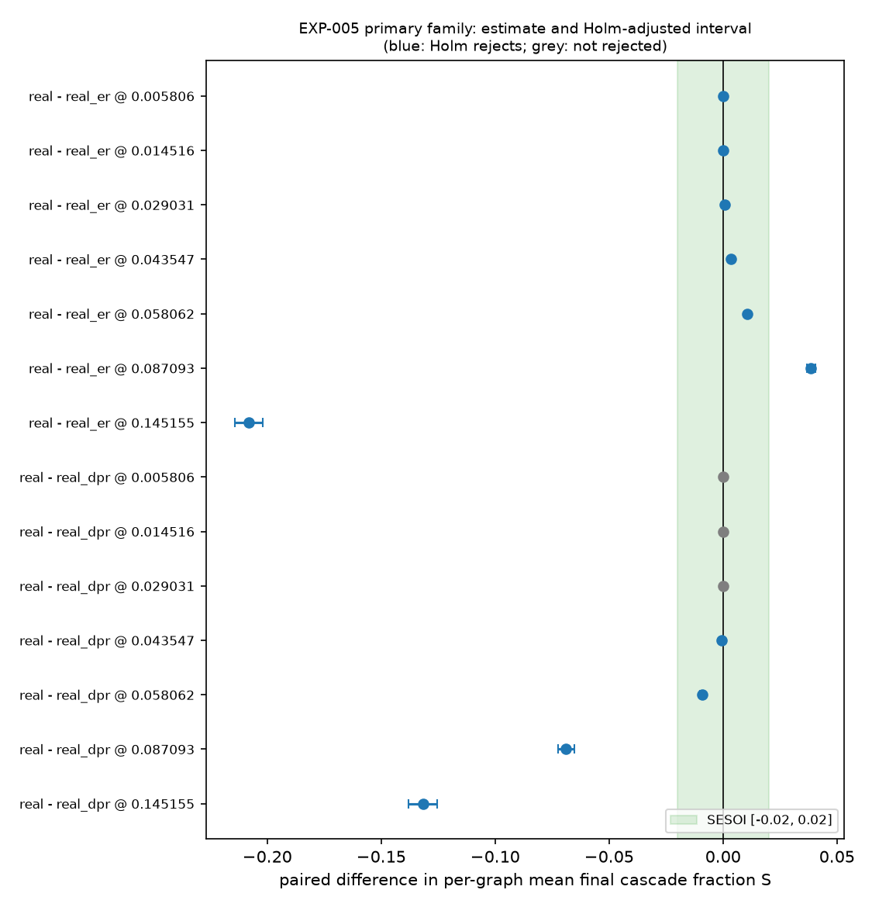
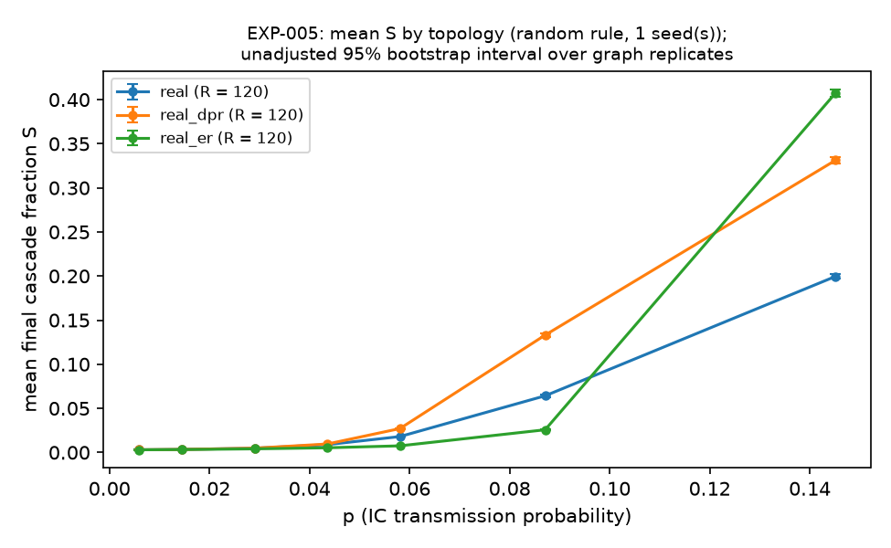

<!-- SPDX-License-Identifier: LicenseRef-VIRAL-NC-Research-1.0 -->
# EXP-005 report: second test on a real network (independent cascade)

## 1. Identification

- Experiment: EXP-005 (secondary, confirmatory second test). Report version 1.1, 2026-11-25 (M4: evidence-audit corrections and addendum; version 1.0 of the same date was the M3 report). Status: **complete. The full frozen matrix ran, with no failed or dropped run.**
- Authorship: Mohamed Bechir Kefi (no affiliation). An AI research and development assistant (Claude, Anthropic) ran the experiment and drafted this report under the owner's direction; it is not an author.
- Experiment protocol v1.0, SHA-256 `ba77b7ef31cb7ed864a6bf0bdbe9910ec88c36399e479a9d5a56314d773847a3`. Study protocol SHA-256 `d984f2f8f2fba8f5ddabe097b0a82be8d17ab652422769f9c22cc442f1a17b32`. Data manifest SHA-256 `ffb8eaf7b0d0beb556649e4bbc64ee9f16de43f5eb66ff8ea81d5ec8f5e2af23`.
- Provenance revision `32961c3c399263ff3e39a9dbd3f78be3ff934922`, clean tree.
- Written from committed files only, with the owner's approval of 2026-11-25 (D-013).
- A simulation on one anonymized friendship network. No statement about Facebook, its algorithms or any platform follows.

## 2. Executive summary

- **Question.** On one real social network, at matched transmission probability, does IC final size differ from (a) G(n, M) graphs with the same n and M (`real_er`) and (b) degree-preserving randomisations of the network (`real_dpr`)?
- **Method.** 7 calibrated `p` values at the same multiples of the network's threshold estimate as the EXP-002 grid. 120 matched sets of 200 cascades, one random seed, and 14 contrasts in one Holm family.
- **Outcome.** 11 of 14 rejected.
  - Real minus `real_er`: all 7 rejected. The difference is small and positive up to `p = 0.0871` (+0.0385 [+0.0367, +0.0405] there) and large and negative at `p = 0.1452` (-0.2080 [-0.2141, -0.2018]).
  - Real minus `real_dpr`: 4 of 7 rejected, all negative, largest -0.1317 [-0.1380, -0.1253] at `p = 0.1452`. The 3 non-rejections have intervals inside the SESOI.
- **Caveat.** The inference is conditional on this single 362-node network.

## 3. Rationale and data

The study complements the synthetic EXP-002 with one real topology, as the owner approved on 2026-11-24 (licence recheck clean, D-008; ratified D-011).

The data are B. F. Maier's anonymized Facebook friendship network (fall 2014): 362 nodes, 1988 edges, pseudonymous integer ids. It comes from GitHub `benmaier/BFMaierFBnetwork` at commit `d1446af55483c98d93f72015b6238200e1a30575` under the MIT License; cite Maier and Brockmann, Phys. Rev. E 96, 042307 (2017). Raw GML SHA-256 `cb94e2c6a02c4f8457730418fd4413d5abb75783f65c02b990eb1dade4a41aaa`; processed SHA-256 `e286957db7367d10bf401217116787ee4a7ccef0fd6a70ebbcb20e427fc529cc`. Both files were verified before the run, and both are git-ignored, never committed.

## 4. Hypotheses and definitions

- For each calibrated `p_j` and each null N in {`real_er`, `real_dpr`}: H0 `Delta_N(p_j) = 0` and H1 `Delta_N(p_j) != 0`.
- `Delta_N(p_j) = E_r[ Sbar_{real,r}(p_j) - Sbar_{N,r}(p_j) ]`.
- One Holm family of 14 at 0.05, with protocol 11.3 intervals. Equivalence only inside `[-0.02, 0.02]`.

## 5. Methodology

- **Calibration.** Done before any diffusion run, from the degree sequence only (exploratory journal entry `EXP-005-calibration-fit-20261124`). `p_c(G_real) = 0.0483851339839852`, and the grid is `round(c p_c, 6)` with c in {0.12, 0.30, 0.60, 0.90, 1.20, 1.80, 3.00}, giving `p` = 0.005806, 0.014516, 0.029031, 0.043547, 0.058062, 0.087093, 0.145155.
- **Graphs** (`tables/graphs.csv`):

| statistic | real | real_er (mean of 120) | real_dpr (mean of 120) |
|---|---|---|---|
| mean degree | 10.98 | 10.98 | 10.98 |
| `<k^2>` | 237.98 | 131.23 | 237.98 |
| clustering | 0.5812 | 0.0303 | 0.0984 |
| giant-component fraction | 0.9088 | 1.0 | 0.9608 |

- `real_dpr` uses `10 M = 19,880` seeded swaps.
- Master seed 20261128. Cascade streams are shared across the three arms by replicate. Bootstrap stream `SeedSequence(20261128, spawn_key=(2,))`, `B = 10000`.
- Hardware as in EXP-002. Budget 30 minutes; runtime 138.3 s.

## 6. Implementation verification

The suite passed 174 tests before the run, including the real-data ingestion and freeze tests. `load_processed` refuses a file whose SHA-256 differs from the pinned value, and the run loaded the pinned file. 360 graphs were checked against the tolerance, with 0 failures. The analysis code was committed before the run.

## 7. Execution record

- Command: `nice -n 10 .venv/bin/viral run --config experiments/EXP-005/config.json --out results/raw/confirmatory/EXP-005`.
- Config file SHA-256 `06b507e45eef7d299a6579e98038aae7e69d76d4f368eaed9b5f51ebeb20f758`. Canonical hash `d277f271e6863fba0f5a3ee24796b1e94e273c5c7f4a4276c20e8e7a651218ae`.
- Run `EXP-005-20261124T233932Z-d277f271`: 2026-11-24T23:39:32Z to 23:41:50Z (UTC). Runtime 138.3 s, peak RSS 96,452,608 bytes, exit status 0.
- Counts: 360 graphs, 2,520 cells and 504,000 cascades, the complete matrix. No run was dropped, failed or retried.
- Deviations: none in design or analysis. The raw result (24 MB, aggregate simulation output, no row-level edges) is git-ignored with its SHA-256 committed (D-012).

## 8. Results

### 8.1 Primary family (Holm over 14)

Source: `results/confirmatory/EXP-005/EXP-005-20261124T233932Z-d277f271/primary_contrasts.csv`; claims `EXP-005-R01` to `EXP-005-R14`. Each contrast uses 120 matched sets.

| contrast | p | mean diff | interval | level | Holm p | rejected | inside SESOI |
|---|---|---|---|---|---|---|---|
| real - real_er | 0.005806 | +0.0000 | [+0.0000, +0.0000] | 0.9950 | < 1e-4 | yes | yes |
| real - real_er | 0.014516 | +0.0001 | [+0.0001, +0.0001] | 0.9944 | < 1e-4 | yes | yes |
| real - real_er | 0.029031 | +0.0007 | [+0.0007, +0.0008] | 0.9938 | < 1e-4 | yes | yes |
| real - real_er | 0.043547 | +0.0036 | [+0.0033, +0.0038] | 0.9929 | < 1e-4 | yes | yes |
| real - real_er | 0.058062 | +0.0105 | [+0.0100, +0.0111] | 0.9917 | < 1e-4 | yes | yes |
| real - real_er | 0.087093 | +0.0385 | [+0.0367, +0.0405] | 0.9900 | < 1e-4 | yes | no |
| real - real_er | 0.145155 | -0.2080 | [-0.2141, -0.2018] | 0.9875 | < 1e-4 | yes | no |
| real - real_dpr | 0.005806 | -0.0000 | [-0.0000, +0.0000] | 0.9833 | 0.6868 | no | yes |
| real - real_dpr | 0.014516 | +0.0000 | [-0.0000, +0.0000] | 0.9833 | 0.2646 | no | yes |
| real - real_dpr | 0.029031 | -0.0000 | [-0.0001, +0.0000] | 0.9833 | 0.6868 | no | yes |
| real - real_dpr | 0.043547 | -0.0007 | [-0.0010, -0.0004] | 0.9964 | < 1e-4 | yes | yes |
| real - real_dpr | 0.058062 | -0.0091 | [-0.0101, -0.0081] | 0.9962 | < 1e-4 | yes | yes |
| real - real_dpr | 0.087093 | -0.0688 | [-0.0724, -0.0653] | 0.9958 | < 1e-4 | yes | no |
| real - real_dpr | 0.145155 | -0.1317 | [-0.1380, -0.1253] | 0.9955 | < 1e-4 | yes | no |

### 8.2 Levels (descriptive) and secondary estimates

Mean `S` (`topology_means.csv`):

| p | real | real_er | real_dpr |
|---|---|---|---|
| 0.005806 | 0.0030 | 0.0030 | 0.0030 |
| 0.014516 | 0.0034 | 0.0033 | 0.0034 |
| 0.029031 | 0.0048 | 0.0041 | 0.0048 |
| 0.043547 | 0.0088 | 0.0053 | 0.0096 |
| 0.058062 | 0.0180 | 0.0075 | 0.0270 |
| 0.087093 | 0.0642 | 0.0257 | 0.1330 |
| 0.145155 | 0.1996 | 0.4076 | 0.3313 |

Secondary grid means (unadjusted 95 percent): real - real_er -0.0221 [-0.0228, -0.0213]; real - real_dpr -0.0300 [-0.0308, -0.0293].

### 8.3 Figures

*Figure EXP-005-F1. Paired difference in per-graph mean `S` (real network minus null) at each calibrated `p`, with Holm-step percentile intervals (levels 0.9833 to 0.9964). Grey: not rejected. Green band: SESOI. R = 120 matched sets.*

*Figure EXP-005-F2. Mean over 120 batches or replicates of per-graph mean `S` by `p` for the real network, `real_er` and `real_dpr`, with unadjusted 95 percent bootstrap intervals.*

## 9. Interpretation

- **Verdict under the frozen rule.**
  - H1 is supported for 11 of 14 contrasts, and 4 of these exceed the SESOI.
  - For real - real_dpr at the three smallest `p`, H1 is not supported, and the intervals lie inside the SESOI. Equivalence within 0.02 is supported there.
- **Expected versus observed.** The protocol made no directional prediction.
  - Against `real_er`, the real network spreads slightly more below its threshold region and much less at the largest `p`. This is the same crossing shape as BA versus ER in EXP-002, and consistent with its heavier degree tail (`<k^2>` 237.98 against 131.23).
  - Against `real_dpr`, which holds the degree sequence fixed, the real network spreads less whenever a difference is detectable.
- **Model-dependent reading.** The structure beyond the degree sequence (clustering 0.5812 against 0.0984, and a smaller giant component, 0.9088 against 0.9608) reduces IC final size on this network. Part of this may come from component structure rather than clustering (limitation 16).

## 10. Threats to validity

- The network is a single, small (362 nodes) friendship circle of one person, not a sample of networks. Its 14 isolated nodes and 20 components influence random-seed outcomes.
- The real arm is the same graph in every replicate, so the inference concerns this network only.
- The calibration uses the tree-like threshold estimate.
- Simulation only; no platform claim.

## 11. Conclusion

On this one anonymized friendship network:

- IC final size differs from size- and density-matched random graphs in a `p`-dependent way, up to -0.2080 [-0.2141, -0.2018] at the largest calibrated `p`.
- With the degree sequence held fixed, the network's other structure lowers final size, by up to -0.1317 [-0.1380, -0.1253].

No generalisation beyond this network follows.

## 12. Reproduction appendix

See `reproduction.md`.

## Addendum (M4, 2026-11-25): component structure, an exploratory check

**This addendum does not change the frozen verdict of section 9.**

- **Competing explanation (limitation 16).** The real network has a smaller giant component than its degree-preserving randomisations (0.9088 against 0.9608). Part of the real - real_dpr deficit could come from component structure rather than clustering.
- **Exploratory check X2 (post hoc, master seed 20261202, R = 30, unadjusted 95 percent intervals).**
  - The check records whether each seed lies in the giant component of its graph, and the cascade size divided by the giant-component size.
  - Over all cascades, real - real_dpr at `p = 0.145155` is -0.1309 [-0.1387, -0.1231], close to the confirmatory -0.1317.
  - Restricted to giant-seeded cascades and normalised by giant-component size, the deficit is -0.1177 [-0.1259, -0.1100] at `p = 0.145155` and -0.0687 [-0.0748, -0.0625] at `p = 0.087093`.
  - The component difference therefore explains only a small part of the deficit. Most of it remains attributable to other structure beyond the degree sequence, such as clustering or degree correlations, which X2 does not separate.
  - Rows: claims M4-X2-01 to M4-X2-14.
- **Evidence audit.** Every number in this report was traced to a committed file, and the frozen analysis was recomputed from the raw result with no difference.
