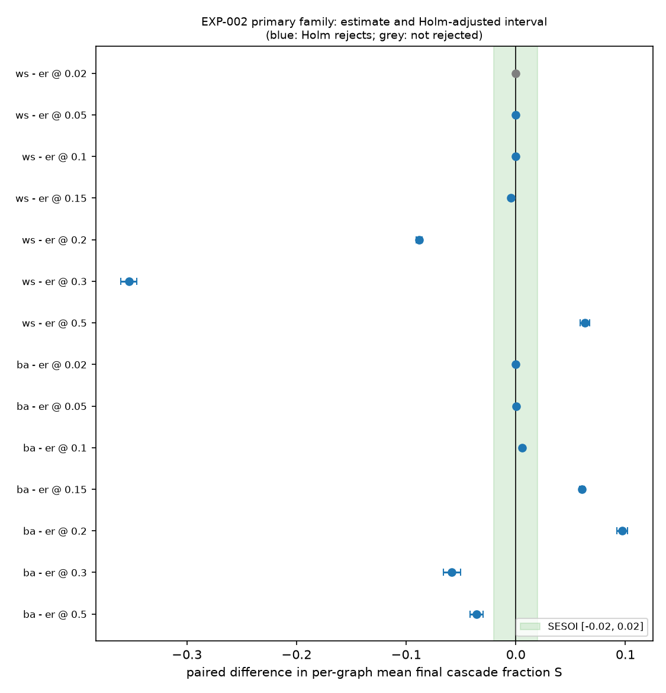
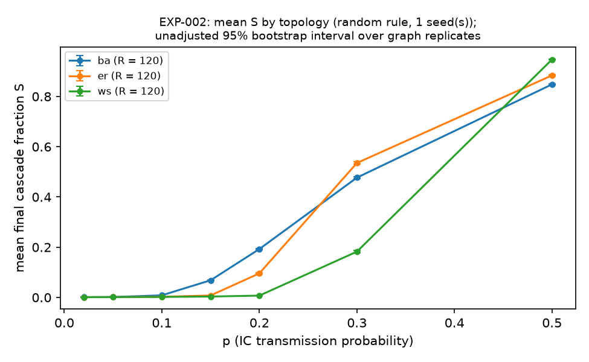
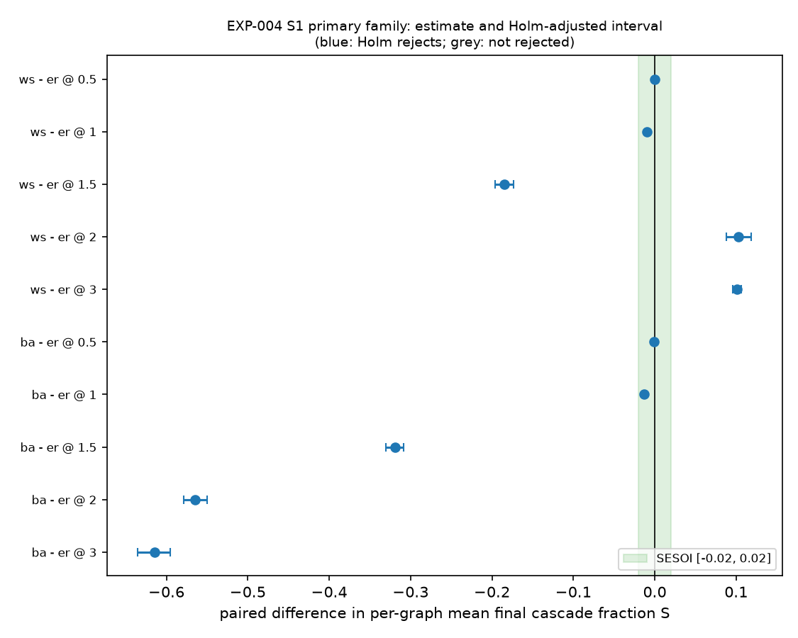
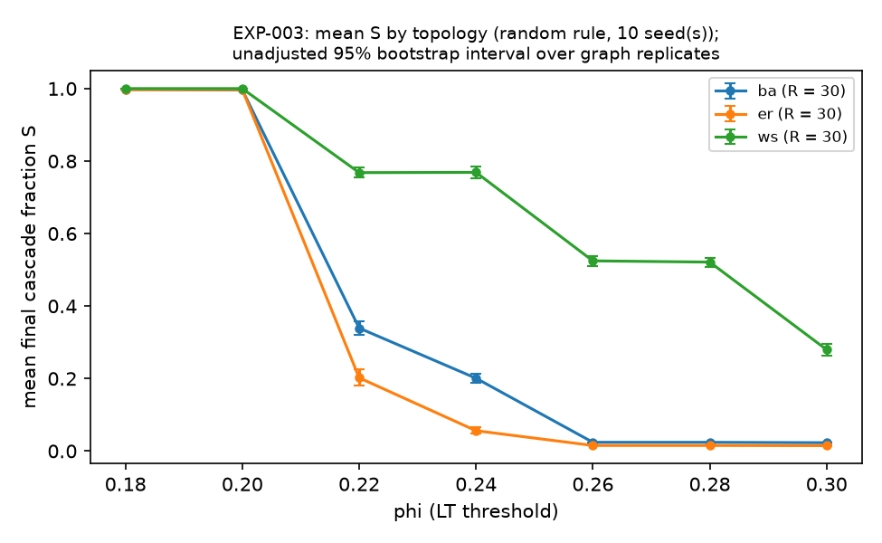
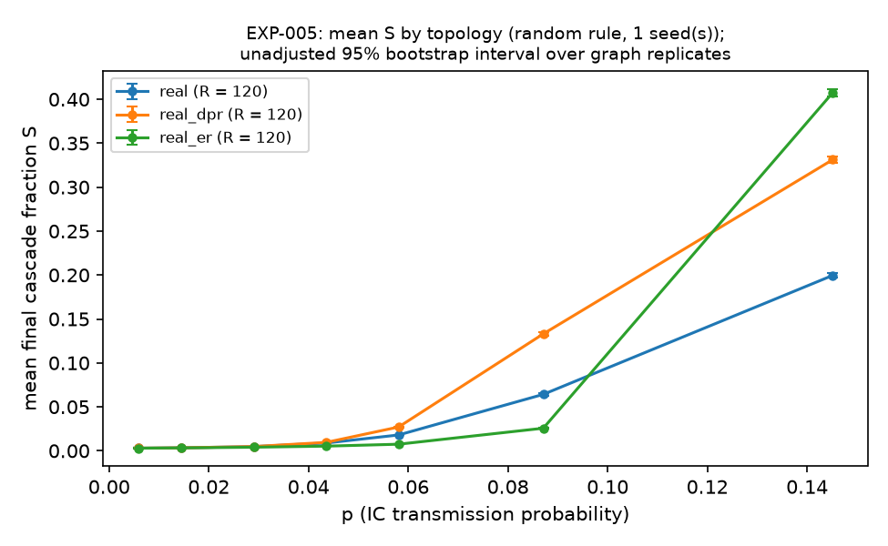

<!-- SPDX-License-Identifier: LicenseRef-VIRAL-NC-Research-1.0 -->
<!-- Canonical source. Version 0.2, synthesised at M4 (2026-11-25) from committed results only, revised after the second review pass; every number is traced by scripts/audit_evidence.py (research/publication/number_trace.csv). Second review pass: research/publication/review_pass_2.md. -->

---
title: "Topology and initial exposure in simulated diffusion: preregistered matched comparisons of independent-cascade and threshold models on random, small-world and scale-free graphs"
author: "Mohamed Bechir Kefi (no affiliation)"
date: "2026-11-25"
status: "Independent research manuscript / preprint draft, not peer-reviewed"
---

# Topology and initial exposure in simulated diffusion: preregistered matched comparisons of independent-cascade and threshold models on random, small-world and scale-free graphs

**Status.** Independent research manuscript / preprint draft, not peer-reviewed. Version 0.2 (M4, after the second review pass), 2026-11-25. The title was approved by the owner on 2026-11-25 (decision log D-015). All results are simulations of stylised models. Nothing in this manuscript describes a real social platform, its algorithms, or any guarantee of virality.

## Author and affiliation metadata

Mohamed Bechir Kefi (no affiliation). An AI research and development assistant (Claude, Anthropic) was used for code, analysis and drafting under the author's direction; it is not an author (section 11).

## Abstract

In simulated diffusion, network structure alone can change how far identical content spreads. We ask, in simulation only, how topology and initial exposure change diffusion when content quality is held fixed by a common transmission probability `p` or adoption threshold `phi`. We compare Watts-Strogatz (WS) and Barabasi-Albert (BA) graphs with Erdos-Renyi (ER) graphs of matched size (1000 nodes) and mean degree (6) under a protocol frozen before any confirmatory run, with 120 matched graph replicates and Holm-controlled paired bootstrap intervals. Under the independent cascade model, 7 of 14 per-`p` contrasts exceed the pre-registered smallest effect size of interest (plus or minus 0.02 in final cascade fraction), and both contrasts change sign with `p`: BA exceeds ER near threshold (+0.0969 [+0.0921, +0.1018] at `p` = 0.20) and falls below it at larger `p`, while WS falls far below ER at `p` = 0.30 (-0.3529 [-0.3601, -0.3456]). Holm rejects 13 of 14, but six of these rejections are detectable yet negligible. A degree-preserving null makes the BA advantage near threshold disappear, so it is a degree-sequence effect; edge matching and two other sizes leave the pattern unchanged. Under a fractional-threshold model the WS ordering reverses (+0.3664 [+0.3602, +0.3727] on the grid mean). On one real 362-node friendship network, structure beyond the degree sequence lowers final size by up to 0.1317. Within these models, topology effects are large but are not one effect: their sign and size depend on `p` and on the contagion rule.

## Keywords

network diffusion; independent cascade; threshold model; percolation; degree heterogeneity; preregistration; simulation

## 1. Introduction

Two pieces of content of identical appeal can reach very different audiences. A common intuition attributes the difference to the content. A second explanation is structural: the network through which content passes determines how far a fixed transmission process can travel. Separating the two is hard in observational data because content and network co-vary. In a simulation, content quality can be held fixed by construction, and the structural question can be asked directly.

The research question of this study is: **how do network topology and initial exposure influence diffusion independently of content quality?** Content quality is not modelled as an attribute. It is held fixed by giving every edge the same transmission probability `p` (independent cascade, IC) or every node the same fractional threshold `phi` (linear-threshold style, LT). Any difference between topologies at matched `p` or `phi` is then a structural difference within the model.

The mechanisms involved are known. Under IC on locally tree-like random graphs, final cascade size is governed by bond percolation, and the threshold depends on the first two moments of the degree distribution (section 2). The contribution of this study is therefore not a new mechanism. It is a small, matched, fully reproducible comparison that (a) is registered and frozen before any confirmatory result, (b) treats the graph, not the cascade, as the independent unit, (c) tests in advance whether degree moments explain the topology differences, and (d) reports every planned arm, including null, negligible and contradictory results.

**Hypotheses.** For WS and BA against the ER baseline, and for each `p` of a frozen grid, H0 states that the expected final cascade fraction does not differ; H1 is nondirectional (section 4.4). A directional expectation (BA above ER at small `p`, with a possible crossing at large `p`) was recorded but not tested.

**Contributions.**

1. A frozen, hash-pinned protocol for five registered experiments, with owner approval recorded before any confirmatory run (`research/freeze.json`).
2. A matched IC comparison (EXP-002, 2,016,000 cascades) with replicate-level paired inference, Holm control and a smallest effect size of interest (SESOI) that separates detectable from practically important differences.
3. A pre-registered sensitivity programme (EXP-004) that tests degree moments, edge-count mismatch and finite size as competing explanations.
4. A model-dependence check under fractional-threshold diffusion (EXP-003) and a conditional second test on one real network (EXP-005).
5. Exploratory, clearly labelled confounder checks added at the interpretation stage (section 5.5), which never replace a frozen verdict.
6. A public evidence trail: every number in this manuscript is traced to a result file, run id, configuration hash and code revision (section 10).

## 2. Related work

This is not a systematic review. Sources were found by web search, and each is cited at the level at which it was actually read (`research/literature_review.md`; claims EXT-01 to EXT-09).

**Percolation and degree heterogeneity.** Newman, Strogatz and Watts (2001; abstract read) develop the theory of random graphs with arbitrary degree distributions, including the transition at which a giant component forms. Pastor-Satorras and Vespignani (2001; abstract read) report that a spreading model on scale-free networks has no epidemic threshold, and Pastor-Satorras et al. (2015; abstract read) review epidemic processes on complex networks. The threshold estimate used in this study, `p_c = <k> / (<k^2> - <k>)`, is the standard locally tree-like bond-percolation expression; it was not checked against the full text of these papers and is stated here as a definition (section 3), not as a cited result.

**Graph families.** The BA model generates heavy-tailed degree distributions by growth with preferential attachment (Barabasi and Albert 1999; abstract read). The WS model rewires a ring lattice (Watts and Strogatz 1998), and the random-graph baseline follows Gilbert (1959); the `G(n, M)` variant is commonly credited to Erdos and Renyi, which was not verified here. These are cited as attributions only (metadata verified, texts not read). The implementations used are those of networkx 3.7 (documentation opened).

**Threshold contagion.** Watts (2002; full text opened) defines a model in which a node adopts when at least a fraction `phi` of its neighbours have adopted, and describes a cascade window bounded as a function of the average degree. The threshold idea is attributed to Granovetter (1978) and the term "complex contagion", with the argument that clustering supplies the repeated exposure thresholds require, to Centola and Macy (2007); both are cited at metadata level only.

**Influence and seeding.** Kempe, Kleinberg and Tardos (2003; journal version 2015, abstract read) study the choice of initial adopters under widely studied diffusion models; the abstract does not name the IC model, so the IC definition is stated in full in section 3. Kitsak et al. (2010; abstract read) report that the most efficient single spreaders sit in the k-core rather than simply having the highest degree. This study uses only random and highest-degree seeding.

**Outcome inequality.** Salganik, Dodds and Watts (2006) and Goel et al. (2016) motivate attention to the unpredictability and structure of cascades; both are cited at metadata level and nothing here depends on their content.

**Position of this study.** The study replicates and integrates known structural results in one matched design; it does not claim a new mechanism or novelty. Its distinguishing features are procedural: preregistration, matched paired inference at the graph level, an explicit SESOI and a planned attempt to explain the topology differences away.

## 3. Background and formal model

**Graphs.** A graph `G = (V, E)` has `N = |V|` nodes, degree `k_i` for node `i`, mean degree `<k>` and second moment `<k^2>`. The three synthetic families, at `N = 1000` and target `<k> = 6`, are: ER `G(n, M)` with `M = 3000` edges; WS ring lattice with `k = 6` and rewiring probability `beta = 0.1`; BA with `m = 3` edges per new node, which gives `m (N - m) = 2991` edges and mean degree 5.982. The tree-like threshold estimate is `p_c(G) = <k> / (<k^2> - <k>)`.

**Independent cascade (IC).** At round 0 the seed set `A_0` is active. A node activated at round `t` gets one chance, at round `t + 1`, to activate each neighbour that was inactive at the start of that round, independently with probability `p`. The process stops when a round activates nobody. Each node is activated at most once (a tested invariant).

**Fractional threshold (LT).** At each synchronous round, an inactive node with at least one neighbour activates if the fraction of its neighbours active at the start of the round is at least `phi`. Given the graph and the seed set, the process is deterministic. A node with no neighbours is never activated unless it is a seed.

**Outcome.** The primary outcome is the final cascade fraction `S = |A_final| / N`, in `[1/N, 1]` for one seed. Secondary outcomes (depth, duration, time to half, Gini coefficient of cascade sizes, large-cascade share, variance decomposition) are defined in `research/protocol.md` section 4 and reported in the experiment reports.

**Estimand.** For treatment topology `T` and control `C` at parameter `x`, `Delta_{T,C}(x) = E_r[ Sbar_{T,r}(x) - Sbar_{C,r}(x) ]`, where `Sbar_{T,r}(x)` is the mean of `S` over the `C = 200` cascades on replicate `r` of `T`. Replicates sharing an index `r` form a matched set: same `N`, same target `<k>`, and a shared cascade random stream (common random numbers).

**Complexity.** One IC cascade costs `O(N + |E|)` in the worst case. The full confirmatory programme of EXP-002 ran 2,016,000 cascades in 1047.8 s in a single process on a laptop (section 4.6).

## 4. Methods

### 4.1 Design and registration

Five experiments were registered (`research/experiment_registry.csv`; Table 1). The study protocol and the five experiment protocols were frozen at version 1.0 on 2026-11-24 with the owner's approval, before any confirmatory run; their SHA-256 hashes are in `research/freeze.json`. Before the freeze, exploratory pilot values of the primary contrast were seen at 10 replicates, and the choice of a per-`p` primary analysis, of `R = 120` and of the EXP-003 threshold grid was informed by them. This is disclosed in the freeze record (item C4) and is a limitation (section 7). The confirmatory runs used new master seeds fixed at the freeze.

**Table 1. Registered experiments.** Status and counts from the run manifests and `analysis.json` files.

| id | role | question | runs | cascades |
|---|---|---|---|---|
| EXP-001 | exploratory | engine verification, smoke matrix, planning probe | 3 exploratory runs | 5,250 per smoke run |
| EXP-002 | primary, confirmatory | IC: WS and BA against ER at 7 values of `p` | 1 | 2,016,000 |
| EXP-003 | secondary, confirmatory | LT: does the ordering depend on the contagion model? | 1 | 504,000 |
| EXP-004 | confirmatory sensitivity | S1 threshold rescaling, S2 degree-preserving null, S3 exact edge matching, S4 size (optional) | 5 | 552,000 in total |
| EXP-005 | secondary, confirmatory | IC on one real network against two nulls | 1 | 504,000 |

### 4.2 Graphs and data

Synthetic graphs were generated with networkx 3.7 from seeds derived by `numpy.random.SeedSequence` keyed by experiment master seed, topology and replicate. Every graph was checked against a 1 percent mean-degree tolerance; there were 0 failures across all confirmatory runs. Table 2 gives the realised graph statistics of EXP-002.

**Table 2. Graph statistics of EXP-002** (means over 120 graphs per topology; `results/confirmatory/EXP-002/EXP-002-20261124T233447Z-2c7febb6/tables/graphs.csv`; claims EXP-002-G-er, -ws, -ba).

| statistic | ER | WS | BA |
|---|---|---|---|
| edges | 3000.0 | 3000.0 | 2991.0 |
| `<k^2>` | 41.96 | 36.57 | 84.53 |
| `p_c` estimate | 0.1669 | 0.1963 | 0.0765 |
| average clustering | 0.0060 | 0.4428 | 0.0307 |
| giant-component fraction | 0.9975 | 1.0000 | 1.0000 |

WS has a narrower degree distribution than ER (smaller `<k^2>`) and strong clustering; BA has a much heavier tail and a threshold estimate less than half that of ER.

### 4.3 Real network (EXP-005)

The real network is B. F. Maier's anonymized Facebook friendship network (fall 2014), published with an MIT licence in the repository `benmaier/BFMaierFBnetwork` (commit `d1446af`); its author asks that Maier and Brockmann (2017) be cited. It has 362 nodes, 1988 edges, 14 isolated nodes and 20 components, giant-component fraction 0.9088 and average clustering 0.5812 (`data/real_network_calibration.json`). Only node ids and edges were downloaded; row-level files are git-ignored and never committed. The EXP-005 transmission grid was calibrated before any diffusion run, from the degree sequence only: `p_j = round(c_j p_c(G_real), 6)` with fitted `p_c(G_real) = 0.0483851339839852` and multipliers `c_j` in {0.12, 0.30, 0.60, 0.90, 1.20, 1.80, 3.00}, the same multiples of threshold as the EXP-002 grid relative to the ER planning threshold `1/<k>`. The two nulls are `real_er`, `G(n, M)` with the same `n` and `M`, and `real_dpr`, the real network after `10 M` = 19,880 seeded double-edge swaps.

### 4.4 Hypotheses, contrasts and decision rules

- **EXP-002 (primary).** For `T` in {WS, BA} and `p` in {0.02, 0.05, 0.10, 0.15, 0.20, 0.30, 0.50}, one uniformly random seed: H0 `Delta_{T,ER}(p) = 0`, H1 `Delta_{T,ER}(p) != 0`. The 14 contrasts form one Holm family at familywise level 0.05.
- **EXP-003.** LT, `phi` in {0.18, 0.20, ..., 0.30}, ten uniformly random seeds; the grid mean of `Delta` for WS and BA, a Holm family of 2.
- **EXP-004.** S1: `p = min(1, c p_c(G))` per graph with `c` in {0.5, 1, 1.5, 2, 3}, 10 tests. S2: BA minus its degree-preserving randomisation (`ba_dpr`), 7 tests. S3: ER and WS trimmed to 2991 edges, 14 tests. S4 (optional): `N` in {500, 2000}, 14 tests per size. Holm within each analysis.
- **EXP-005.** Real minus `real_er` and real minus `real_dpr` at each calibrated `p_j`, 14 tests.
- **Equivalence.** A contrast is called practically negligible only if its reported interval lies entirely inside the SESOI `[-0.02, +0.02]`. A non-rejection is never read as equivalence on its own.
- **What would invalidate the "topology" reading (EXP-004 protocol item 6).** S1 or S2 showing no difference where EXP-002 shows one; the effect is then reported as a degree-sequence effect.

### 4.5 Statistical analysis

The independent unit is the matched set `r`, not the cascade. For each contrast, the `R` paired replicate differences are resampled with one shared `B = 10000` by `R` matrix of bootstrap indices, drawn from `SeedSequence(master, spawn_key=(2,))`, so resamples stay paired across contrasts. Two-sided bootstrap p-values are `min(1, 2 min(P*(m* <= 0), P*(m* >= 0)))`, with resolution `1/B` (a value of 0 is reported as `< 1e-4`). Holm step-down orders contrasts by p-value; the reported interval of a contrast at step `i` is the percentile interval at level `1 - 0.05/(m - i)` up to the first non-rejection `j*`, and at level `1 - 0.05/(m - j*)` after it (protocol section 11.3). Secondary estimates, such as grid means and the non-primary exposure conditions, carry unadjusted 95 percent percentile intervals from a separate stream and are labelled secondary. With `R = 120` and common random numbers, the design detects differences far below the SESOI: for example, WS - ER at `p = 0.05` is -3.27e-05 and is rejected (claim SYN-10). Every rejection is therefore reported together with whether its interval lies inside the SESOI.

### 4.6 Implementation, verification and resources

The engine is a vectorised IC and LT implementation, tested for exact agreement with plain-loop reference implementations, together with no-transmission and all-transmission cases, disconnected components, duplicate activation, graph invariants, hand-computed examples, determinism and invalid inputs. The test suite passed 174 tests before the confirmatory runs. An exploratory smoke run verified 5,250 cascades with 0 failures, and 54 known-case metric checks passed (EXP-001). The confirmatory analysis code was committed (revision `32961c3`) before any confirmatory output existed. All eight confirmatory runs used that revision with a clean tree, on an Apple M1 Pro laptop (macOS 15.3.1, Python 3.12.1, numpy 2.5.4, networkx 3.7), and every one exited with status 0, without retry or dropped cells. Runtimes: EXP-002 1047.8 s, EXP-003 502.4 s, EXP-004 351.1 s over five runs, EXP-005 138.3 s.

### 4.7 Exploratory work

EXP-001 and the M4 checks of section 5.5 are exploratory. The M4 checks were designed after the confirmatory results were seen, use fresh master seeds (20261201 to 20261203), 30 replicates and unadjusted intervals, and do not change any frozen verdict. They are reported because they address competing explanations named in the protocols that the confirmatory design left open.

## 5. Results

### 5.1 EXP-002: independent cascade on matched synthetic graphs

Holm rejects H0 for 13 of 14 contrasts (Table 3, Figure 1). The only non-rejection is WS - ER at `p = 0.02`, whose interval lies inside the SESOI. Seven intervals lie entirely outside the SESOI; the other seven lie inside it, and six of those are rejected: detectable but negligible. "Inside the SESOI" means small in absolute terms only. At `p = 0.10`, for example, mean `S` is 0.0084 on BA against 0.0025 on ER, a large relative difference that the frozen absolute SESOI classifies as negligible.

**Table 3. EXP-002 primary family** (14 tests, Holm; `results/confirmatory/EXP-002/EXP-002-20261124T233447Z-2c7febb6/primary_contrasts.csv`; claims EXP-002-R01 to R14). Interval: Holm-step percentile interval at the stated level. `R = 120` matched sets per contrast.

| contrast | `p` | mean difference in `S` | interval | level | rejected | inside SESOI |
|---|---|---|---|---|---|---|
| WS - ER | 0.02 | -1.17e-06 | [-3.37e-06, +9.58e-07] | 0.9500 | no | yes |
| WS - ER | 0.05 | -3.27e-05 | [-4.01e-05, -2.59e-05] | 0.9929 | yes | yes |
| WS - ER | 0.10 | -0.0004 | [-0.0004, -0.0003] | 0.9917 | yes | yes |
| WS - ER | 0.15 | -0.0043 | [-0.0046, -0.0041] | 0.9900 | yes | yes |
| WS - ER | 0.20 | -0.0884 | [-0.0910, -0.0857] | 0.9875 | yes | no |
| WS - ER | 0.30 | -0.3529 | [-0.3601, -0.3456] | 0.9833 | yes | no |
| WS - ER | 0.50 | +0.0632 | [+0.0589, +0.0676] | 0.9750 | yes | no |
| BA - ER | 0.02 | +0.0000 | [+0.0000, +0.0000] | 0.9964 | yes | yes |
| BA - ER | 0.05 | +0.0003 | [+0.0002, +0.0003] | 0.9962 | yes | yes |
| BA - ER | 0.10 | +0.0059 | [+0.0056, +0.0063] | 0.9958 | yes | yes |
| BA - ER | 0.15 | +0.0604 | [+0.0583, +0.0624] | 0.9955 | yes | no |
| BA - ER | 0.20 | +0.0969 | [+0.0921, +0.1018] | 0.9950 | yes | no |
| BA - ER | 0.30 | -0.0583 | [-0.0659, -0.0503] | 0.9944 | yes | no |
| BA - ER | 0.50 | -0.0358 | [-0.0416, -0.0297] | 0.9938 | yes | no |

*Figure 1 (EXP-002-F1). Paired difference in per-graph mean `S` (treatment minus ER) at each `p`, with the Holm-step percentile interval (levels 0.95 to 0.9964). Blue: rejected; grey: not rejected. Green band: SESOI. R = 120 matched sets; several intervals are narrower than the markers. Source: `primary_contrasts.csv` of run EXP-002-20261124T233447Z-2c7febb6.*

Both contrasts change sign with `p` (claim SYN-01). BA lies above ER from `p = 0.02` to 0.20, by more than the SESOI only at 0.15 and 0.20, and below it at 0.30 and 0.50: the crossing recorded as a directional expectation occurred. WS lies below ER from 0.05 to 0.30 and above it at 0.50. The absolute levels (Figure 2) show why: ER reaches a mean `S` of 0.0957 at `p = 0.20` and 0.5352 at 0.30, while WS stays at 0.0073 and 0.1823, and BA already reaches 0.0683 at `p = 0.15`, where ER is at 0.0079.

*Figure 2 (EXP-002-F2). Mean over 120 replicates of per-graph mean `S` by `p` and topology (IC, one random seed), with unadjusted 95 percent percentile bootstrap intervals over replicates; lines join measured grid points only. Source: `topology_means.csv` of the same run.*

**Secondary estimates (unadjusted).** The grid-mean contrasts, the secondary estimand of the frozen protocol, are WS - ER -0.0547 [-0.0557, -0.0536] and BA - ER +0.0099 [+0.0087, +0.0112]; they hide the sign changes and are not used for any decision. Initial exposure changes magnitudes but not the qualitative ordering of the grid means: with the highest-degree single seed, BA - ER is +0.0707 [+0.0699, +0.0714] and WS - ER -0.0905 [-0.0915, -0.0895]; with ten random seeds, +0.0421 [+0.0418, +0.0425] and -0.0740 [-0.0746, -0.0735]. Targeting the hub amplifies the BA advantage near threshold: with the highest-degree seed, BA - ER is +0.2283 [+0.2268, +0.2298] at `p = 0.15`. In the primary cells, variation between cascades on the same graph dominates the variance of `S` (share 0.9948 at `p = 0.02` and 0.7760 at `p = 0.30`), while the between-topology share peaks at 0.2192 at `p = 0.30` (`tables/variance.csv`).

### 5.2 EXP-004: can the topology differences be explained away?

**Table 4. EXP-004 S1 and S2** (Holm within each analysis; `R = 30`; claims EXP-004-S1-R01 to R10 and EXP-004-S2-R01 to R07). All S1 contrasts and the three S2 contrasts marked "yes" are rejected with Holm p < 1e-4.

| analysis | contrast | parameter | mean difference | interval | rejected | inside SESOI |
|---|---|---|---|---|---|---|
| S1 | WS - ER | c = 0.5 | +0.0001 | [+0.0000, +0.0001] | yes | yes |
| S1 | WS - ER | c = 1 | -0.0100 | [-0.0110, -0.0089] | yes | yes |
| S1 | WS - ER | c = 1.5 | -0.1847 | [-0.1960, -0.1731] | yes | no |
| S1 | WS - ER | c = 2 | +0.1032 | [+0.0883, +0.1187] | yes | no |
| S1 | WS - ER | c = 3 | +0.1014 | [+0.0960, +0.1065] | yes | no |
| S1 | BA - ER | c = 0.5 | -0.0006 | [-0.0006, -0.0005] | yes | yes |
| S1 | BA - ER | c = 1 | -0.0134 | [-0.0146, -0.0122] | yes | yes |
| S1 | BA - ER | c = 1.5 | -0.3194 | [-0.3303, -0.3087] | yes | no |
| S1 | BA - ER | c = 2 | -0.5645 | [-0.5789, -0.5497] | yes | no |
| S1 | BA - ER | c = 3 | -0.6147 | [-0.6350, -0.5953] | yes | no |
| S2 | BA - ba_dpr | p = 0.02 | +0.0000 | [-0.0000, +0.0000] | no | yes |
| S2 | BA - ba_dpr | p = 0.05 | -0.0000 | [-0.0001, +0.0001] | no | yes |
| S2 | BA - ba_dpr | p = 0.10 | -0.0019 | [-0.0028, -0.0010] | yes | yes |
| S2 | BA - ba_dpr | p = 0.15 | -0.0020 | [-0.0063, +0.0023] | no | yes |
| S2 | BA - ba_dpr | p = 0.20 | +0.0073 | [-0.0023, +0.0158] | no | yes |
| S2 | BA - ba_dpr | p = 0.30 | +0.0276 | [+0.0145, +0.0409] | yes | no |
| S2 | BA - ba_dpr | p = 0.50 | +0.0203 | [+0.0116, +0.0295] | yes | no |

*Figure 3 (EXP-004-F1). S1: paired difference in per-graph mean `S` at `p = c p_c(G)`, per multiplier `c`, with Holm-step intervals (levels 0.95 to 0.995). Green band: SESOI. R = 30 matched sets. Source: `primary_contrasts.csv` of run EXP-004-20261124T233447Z-de14a4b3.*

- **S1, threshold rescaling.** At and below each graph's own threshold estimate (`c` = 0.5 and 1), both contrasts are inside the SESOI. Above it (`c` = 1.5, 2, 3), the differences are large, and BA falls far below ER. The frozen S1 criterion refers to multipliers "corresponding" to each EXP-002 `p`, a mapping the frozen texts do not define. The owner decided on 2026-11-25 (decision D-013) that S1 is reported per multiplier, with no overall verdict and no multiplier picked after the data. S1 therefore reclassifies no EXP-002 effect (claim SYN-04).
- **S2, degree-preserving null.** BA and its randomisation are equivalent within 0.02 from `p = 0.02` to 0.20. Under protocol item 6, the BA advantage over ER at `p = 0.15` and 0.20 (+0.0604 and +0.0969 in EXP-002) is a degree-sequence effect (claim SYN-03). Because `BA - ER = (BA - ba_dpr) + (ba_dpr - ER)`, the S2 interval bounds the part of the advantage not carried by the degree sequence: at `p = 0.20` it is at most +0.0158. At 0.30 and 0.50, BA exceeds its randomisation (+0.0276 and +0.0203); at 0.50 the lower bound (+0.0116) lies inside the SESOI, so practical importance there is unresolved.
- **S3, exact edge matching, and S4, size (optional).** Trimming ER and WS to the BA edge count gives 13 of 14 rejections with the same signs and similar magnitudes (WS - ER at `p = 0.30`: -0.3597 [-0.3747, -0.3434]); so do `N = 500` and `N = 2000` (WS - ER at `p = 0.30`: -0.3355 and -0.3578). Neither the edge-count mismatch nor finite size within this range explains the pattern (claim SYN-02; supplementary Tables S4.1 and S4.2). S2 and S3 reuse EXP-002 replicates 0 to 29 and their cascade streams, so their agreement with EXP-002 is partly built in; S4, on new graphs, and the exploratory X1 check on fresh seeds (section 5.5) are the closer independent replications.

### 5.3 EXP-003: fractional-threshold diffusion

Both grid-mean contrasts are rejected and lie outside the SESOI (Table 5). Under LT with ten random seeds, WS lies far above ER, the opposite of its IC deficit near threshold (claim SYN-05).

**Table 5. EXP-003** (primary: grid mean over `phi`, Holm over 2; per-`phi` rows are secondary and unadjusted; `R = 30`; claims EXP-003-R01, R02 and EXP-003-SEC rows).

| row | WS - ER | BA - ER |
|---|---|---|
| primary grid mean (Holm-step interval) | +0.3664 [+0.3602, +0.3727] | +0.0439 [+0.0366, +0.0498] |
| `phi` = 0.18 | +0.0030 [+0.0022, +0.0038] | +0.0007 [-0.0011, +0.0024] |
| `phi` = 0.20 | +0.0030 [+0.0022, +0.0038] | -0.0009 [-0.0029, +0.0010] |
| `phi` = 0.22 | +0.5661 [+0.5389, +0.5932] | +0.1372 [+0.1059, +0.1654] |
| `phi` = 0.24 | +0.7127 [+0.6922, +0.7321] | +0.1447 [+0.1291, +0.1585] |
| `phi` = 0.26 | +0.5094 [+0.4958, +0.5232] | +0.0088 [+0.0085, +0.0092] |
| `phi` = 0.28 | +0.5059 [+0.4934, +0.5184] | +0.0088 [+0.0084, +0.0092] |
| `phi` = 0.30 | +0.2649 [+0.2487, +0.2804] | +0.0082 [+0.0080, +0.0085] |

*Figure 4 (EXP-003-F2). Mean over 30 replicates of per-graph mean `S` by `phi` and topology (LT, ten random seeds), with unadjusted 95 percent bootstrap intervals over replicates. Source: `topology_means.csv` of run EXP-003-20261124T234212Z-a2d668ab.*

At `phi` = 0.18 and 0.20 every topology saturates (mean `S` 0.9970 or above), and the BA - ER intervals include 0. The grid mean is therefore driven by `phi` 0.22 to 0.30. Exposure matters more under LT than under IC: with a single random seed, the BA - ER grid mean is -0.0083 [-0.0185, +0.0021], not distinguishable from 0, while with the highest-degree single seed it is +0.3374 [+0.2917, +0.3854] (secondary, unadjusted).

### 5.4 EXP-005: one real network against two nulls

Holm rejects 11 of 14 contrasts (Table 6). Against `real_er`, the real network spreads slightly more at small `p` and much less at the largest calibrated `p`, the same crossing shape as BA against ER, consistent with its heavier degree tail (`<k^2>` 237.98 against 131.23). Against `real_dpr`, which keeps the degree sequence, the real network spreads less wherever a difference is detectable (claim SYN-06).

**Table 6. EXP-005 primary family** (Holm over 14; `R = 120`; `results/confirmatory/EXP-005/EXP-005-20261124T233932Z-d277f271/primary_contrasts.csv`; claims EXP-005-R01 to R14).

| `p` | real - real_er | rejected / inside SESOI | real - real_dpr | rejected / inside SESOI |
|---|---|---|---|---|
| 0.005806 | +0.0000 [+0.0000, +0.0000] | yes / yes | -0.0000 [-0.0000, +0.0000] | no / yes |
| 0.014516 | +0.0001 [+0.0001, +0.0001] | yes / yes | +0.0000 [-0.0000, +0.0000] | no / yes |
| 0.029031 | +0.0007 [+0.0007, +0.0008] | yes / yes | -0.0000 [-0.0001, +0.0000] | no / yes |
| 0.043547 | +0.0036 [+0.0033, +0.0038] | yes / yes | -0.0007 [-0.0010, -0.0004] | yes / yes |
| 0.058062 | +0.0105 [+0.0100, +0.0111] | yes / yes | -0.0091 [-0.0101, -0.0081] | yes / yes |
| 0.087093 | +0.0385 [+0.0367, +0.0405] | yes / no | -0.0688 [-0.0724, -0.0653] | yes / no |
| 0.145155 | -0.2080 [-0.2141, -0.2018] | yes / no | -0.1317 [-0.1380, -0.1253] | yes / no |

*Figure 5 (EXP-005-F2). Mean over 120 batches or replicates of per-graph mean `S` by calibrated `p` for the real network, `real_er` and `real_dpr`, with unadjusted 95 percent bootstrap intervals. Source: `topology_means.csv` of run EXP-005-20261124T233932Z-d277f271.*

The real network differs from its degree-preserving randomisations in clustering (0.5812 against 0.0984 on average) and in its giant component (0.9088 against 0.9608). The second difference is a competing explanation for the real - real_dpr deficit; section 5.5 examines it.

### 5.5 Exploratory confounder checks (M4, post hoc)

Three competing explanations named in the protocols were not resolved by the confirmatory design. Each was examined with a small exploratory simulation (`scripts/exploratory_m4.py`; `results/exploratory/M4/`; claims M4-X1 to M4-X3 and SYN-07 to SYN-09). These checks are post hoc, use unadjusted 95 percent intervals over 30 matched replicates, and never replace a frozen verdict. Table 7 lists the rows quoted in the text; every row is in supplementary Table S4.3.

**Table 7. Exploratory checks, selected rows** (EXPLORATORY; `results/exploratory/M4/m4_exploratory_contrasts.csv`).

| check | contrast | parameter | mean difference [95 percent, unadjusted] |
|---|---|---|---|
| X1 (IC) | WS - ER, fresh seeds | `p` = 0.30 | -0.3524 [-0.3619, -0.3426] |
| X1 (IC) | WS - ws_dpr | `p` = 0.20 | -0.0212 [-0.0224, -0.0199] |
| X1 (IC) | ws_dpr - ER | `p` = 0.20 | -0.0699 [-0.0742, -0.0657] |
| X1 (IC) | WS - ws_dpr | `p` = 0.30 | -0.3662 [-0.3750, -0.3573] |
| X1 (IC) | ws_dpr - ER | `p` = 0.30 | +0.0137 [+0.0030, +0.0246] |
| X1 (IC) | ws_dpr - ER | `p` = 0.50 | +0.0709 [+0.0634, +0.0779] |
| X2 (IC, real) | real - real_dpr, `S` | `p` = 0.145155 | -0.1309 [-0.1387, -0.1231] |
| X2 (IC, real) | real - real_dpr, giant-seeded and giant-normalised | `p` = 0.145155 | -0.1177 [-0.1259, -0.1100] |
| X2 (IC, real) | real - real_dpr, giant-seeded and giant-normalised | `p` = 0.087093 | -0.0687 [-0.0748, -0.0625] |
| X3 (LT) | WS - ws_dpr | `phi` = 0.22 | +0.7420 [+0.7229, +0.7614] |
| X3 (LT) | ws_dpr - ER | `phi` = 0.22 | -0.2117 [-0.2351, -0.1904] |
| X3 (LT) | BA - ba_dpr | `phi` = 0.22 | -0.4450 [-0.4761, -0.4126] |
| X3 (LT) | ba_dpr - ER | `phi` = 0.22 | +0.5773 [+0.5385, +0.6148] |

- **X1: is the WS deficit under IC a clustering effect or a degree effect?** EXP-002 cannot tell, because WS differs from ER both in clustering (0.4428 against 0.0060) and in having a narrower degree distribution. X1 adds a degree-preserving randomisation of each WS graph (`ws_dpr`, clustering 0.0043). On fresh seeds, WS - ER at `p = 0.30` (-0.3524) reproduces the EXP-002 value (-0.3529). Nearly all of it is structure beyond the degree sequence (WS - ws_dpr -0.3662), while the narrower degree sequence alone slightly raises spread there (+0.0137). Near the IC threshold (`p = 0.20`) both parts contribute, the degree part more (-0.0699 against -0.0212). The WS advantage at `p = 0.50` goes with its degree sequence (+0.0709). The randomisation removes clustering and ring order together, so X1 does not separate the two.
- **X2: is the EXP-005 deficit a component effect?** Restricting to cascades seeded in the giant component and normalising by its size, the real - real_dpr deficit remains (-0.1177 at the largest calibrated `p` against -0.1309 for `S`). The smaller giant component of the real network explains only a small part of the deficit (limitation 16 is narrowed, not removed). X2 does not attribute the remainder to clustering rather than to degree correlations or other structure.
- **X3: under LT, is the ordering a degree-heterogeneity effect?** For WS, no: the degree-preserving randomisation of WS spreads less than ER (-0.2117 at `phi = 0.22`), so the WS advantage comes entirely from its structure beyond the degree sequence. For BA, the direction of the advantage goes with the degree sequence, but BA itself spreads far less than its randomisation (-0.4450 at `phi = 0.22`), so other BA structure strongly restrains threshold cascades. This mechanism was not identified.

### 5.6 Expected versus observed

**Table 8. Expected versus observed, under the frozen rules.** "Expectation" quotes what the protocols recorded before any confirmatory run.

| experiment | expectation recorded before the runs | observation | verdict under the frozen rule |
|---|---|---|---|
| EXP-001 | engine passes every verification check | 0 failures over 5,250 checked cascades; 54 of 54 metric checks | pass (exploratory gate) |
| EXP-002, BA - ER | BA above ER at small `p`, possible crossing at large `p` (not tested) | above at 0.02 to 0.20 (outside SESOI at 0.15, 0.20), below at 0.30 and 0.50 | H1 supported at all 7 `p`; 4 of 7 outside SESOI |
| EXP-002, WS - ER | no direction | below at 0.05 to 0.30, above at 0.50; null at 0.02 | H1 supported at 6 of 7 `p` (3 outside SESOI); not supported at 0.02, equivalence within 0.02 there |
| EXP-003 | ordering "may differ from IC", no direction | WS far above ER; BA modestly above ER | H1 supported for both; both outside SESOI |
| EXP-004 S1 | if differences vanish at matched `p / p_c`, report a degree-heterogeneity effect | inside SESOI at `c` <= 1, far outside at `c` >= 1.5 | per multiplier, no overall verdict (owner, D-013) |
| EXP-004 S2 | if BA equals its randomisation, the BA effect is carried by the degree sequence | equivalent within 0.02 at `p` 0.02 to 0.20; BA higher at 0.30 and 0.50 | BA advantage near threshold is a degree-sequence effect |
| EXP-004 S3 | mismatch might explain small differences | same 13 of 14 pattern | mismatch does not explain the pattern |
| EXP-004 S4 (optional) | finite size might matter | same 13 of 14 pattern at `N` = 500 and 2000 | size in this range does not explain it |
| EXP-005 | no direction | real below `real_dpr` where detectable; crossing against `real_er` | H1 supported for 11 of 14; 3 non-rejections inside SESOI |

## 6. Discussion

### 6.1 Competing explanations, and which results address them

Table 9 lists the competing explanations named in the frozen protocols and states which results address them.

**Table 9. Confounder ledger.**

| conclusion | competing explanation (protocol) | addressed by | status |
|---|---|---|---|
| EXP-002 differences are structural | (a) degree heterogeneity alone | S1 (per multiplier, no verdict), S2 (BA only), X1 (WS, exploratory) | BA near threshold: explained by degree sequence. WS at 0.30: not explained by degree sequence (exploratory). |
| same | (b) residual edge-count mismatch | S3 | ruled out |
| same | (c) finite size | S4 (two sizes) | ruled out for `N` 500 to 2000 only |
| same | (d) cascade-level noise mistaken for topology | replicate-level inference; variance decomposition | addressed: the unit is the graph; within-graph variance dominates but is not the source of the contrasts |
| EXP-003 ordering | seed count dominating | secondary single-seed and highest-degree estimates | partly: with one random seed BA - ER is not distinguishable from 0, WS - ER stays positive (+0.1233) |
| same | degree heterogeneity alone | X3 (exploratory) | not the explanation for WS; for BA the direction only |
| EXP-005 deficit against `real_dpr` | component structure (limitation 16) | X2 (exploratory) | small part only |
| all | pilot exposure before the freeze | new master seeds; frozen analysis committed before the runs | disclosed, cannot be removed (section 7) |

### 6.2 What the evidence supports

Within these models, at matched size, density and transmission probability, network structure changes how far identical content spreads, and the change can be large: in EXP-002 the largest difference is a third of the network. But "the topology effect" is not one quantity. Its sign depends on `p`. For BA against ER, a model-dependent reading fits: each graph has its own threshold on a shared `p` axis. BA's threshold estimate (0.0765) is less than half of ER's (0.1669), so BA cascades take off first and BA leads; above both thresholds, ER's more homogeneous degrees reach more nodes and ER leads. S2 shows that, near threshold, the BA advantage is carried by the degree sequence. This reading was not tested as such, and it fails in the two places described next.

Two results resist the degree-moment reading. First, S1 shows that rescaling by the tree-like threshold estimate equalises the topologies only up to threshold; above it, differences are large. One reading is that `p_c(G)` locates the onset but not the growth of the giant cluster. Another is that BA at `c p_c` runs at a much smaller absolute `p` than ER at the same `c`. The study does not separate them. Second, the WS deficit at `p = 0.30` is not a degree effect in the exploratory X1 check: it comes from WS structure beyond its degree sequence. X1 cannot say whether clustering or ring order is responsible, because the randomisation removes both. The tree-like estimate for WS (0.1963) ignores both.

### 6.3 Model dependence

The ordering of WS against ER reverses between IC and LT. This is consistent with the argument, attributed to Centola and Macy (2007) and not verified against their text, that clustering helps threshold contagion by supplying repeated exposure while it wastes transmissions under simple contagion. X3 supports the structural part of this reading for WS. It also shows that BA, in its own wiring, is much less susceptible to threshold cascades than its degree sequence would allow. Within the families and parameters tested here, a statement that "scale-free" or "small-world" structure promotes spreading is not well posed without the contagion rule and the operating point relative to threshold. Whether this holds for other parameterisations is untested.

### 6.4 Initial exposure

Exposure changes magnitudes more than orderings under IC: seeding the highest-degree node more than triples the BA advantage at `p = 0.15`. Under LT, exposure decides whether BA differs from ER at all. These are secondary, unadjusted estimates.

### 6.5 Relation to prior work

The IC results replicate, in one matched design, the qualitative role of degree heterogeneity described in the percolation literature (section 2). They do not extend it. The procedural contribution is that the explanations were tested in advance and reported whether or not they succeeded: S1 produced no verdict and S2 explained one effect but not another. The confirmatory EXP-002 results should be read as a replication, on new seeds and with a frozen analysis, of a pattern first seen in the pilot (WS - ER at `p = 0.30`: -0.3564 in the pilot at 10 replicates, -0.3529 in the confirmatory run). They are not the confirmation of a prediction made blind.

## 7. Limitations and threats to validity

- **Simulation only.** All results are simulations of stylised models. They support claims only within the model assumptions and say nothing about real platforms, their ranking algorithms or "guaranteed virality".
- **Content quality is not modelled.** It is held fixed by one shared `p` or `phi`. Real content varies in ways these parameters do not capture, and synthetic agents are not people.
- **One parameterisation per family.** One mean degree, one WS `beta` (0.1) and one BA `m` (3). Results do not generalise to all small-world or scale-free graphs.
- **Finite size.** `N = 1000`, with S4 at 500 and 2000 only.
- **Pre-freeze exposure.** The per-`p` primary analysis, `R = 120` and the EXP-003 grid were chosen after pilot values at 10 replicates had been seen (freeze record C4). New seeds and a frozen analysis limit, but do not remove, the risk that the design was tuned to the pilot; the confirmatory values are close to the pilot values (section 6.5).
- **High power, tiny effects.** Holm rejects differences of order 1e-05. Practical importance is judged only by the SESOI, whose value (0.02) is a design choice. The SESOI is absolute, so large relative differences at small `p` are classified as negligible.
- **Error control is per family.** Holm controls the familywise error rate within each of the 8 confirmatory families (89 tests). There is no study-wide correction, and secondary and exploratory intervals are unadjusted.
- **The tree-like threshold estimate** ignores clustering. It underestimates the WS and real-network thresholds, which limits S1 and the EXP-005 calibration.
- **S1 has no overall verdict** (owner decision D-013), so the degree-heterogeneity reading of the EXP-002 effects as a whole is neither confirmed nor refuted.
- **EXP-003 grid dependence.** The grid mean mixes saturated thresholds (0.18, 0.20) and the transition region, and the values at 0.26 and 0.28 nearly coincide. Depth equals duration by construction under the frozen LT definition.
- **One real network.** EXP-005 is conditional on one small, pseudonymous friendship circle. Its real arm is the same graph in every replicate, so its intervals reflect cascade sampling and null-graph variation only. It is not a sample of networks.
- **Exploratory checks are post hoc.** X1 to X3 were designed after the confirmatory results were seen, use 30 replicates and unadjusted intervals, and test one randomisation scheme.
- **Literature.** The review is not systematic, and several sources were verified only at metadata or abstract level (section 2).
- **Reports written after the runs.** The experiment reports were written from committed files after the runs (owner decision D-013), with no recomputation.

The full list is maintained in `research/limitations.md`.

## 8. Ethics and responsible research

No human participants were involved and no personal data were collected. The only real data set is an anonymized friendship network released under an MIT licence. Only ids and edges were used, row-level files are not redistributed, and no result singles out a node. No ethics approval was sought because none was required for this design; none is claimed. The study does not model or recommend strategies to manipulate attention. Seed-selection results concern stylised graphs and should not be read as targeting advice for real people or platforms.

## 9. Conclusion and future work

At matched size, density and transmission probability, topology changes simulated IC final size by more than 0.02 of the network in 7 of 14 tested conditions (Holm rejects 13 of 14), and the sign of the change depends on `p`. The BA advantage near threshold is a degree-sequence effect. The large WS deficit above threshold is not, on exploratory evidence. Under a threshold rule, WS reverses its position. On one real network, structure beyond the degree sequence slows IC spread.

Feasible extensions include several WS `beta` and BA `m` values, a clustering-aware threshold estimate for S1, k-core seeding (Kitsak et al. 2010), a confirmatory version of the X1 to X3 decompositions with a frozen protocol, and a sample of openly licensed real networks.

## 10. Data, code and artifact availability

The repository contains the engine (`src/viral/`), frozen configs (`experiments/`), protocols and reports (`research/experiments/EXP-NNN/`), committed analysis tables and figures (`results/confirmatory/`, `results/exploratory/`), and the freeze record. Raw `result.json` files (up to 100 MB) are git-ignored and regenerated deterministically by `viral run`; their SHA-256 values are committed. Reproduction: `uv sync --locked`, `.venv/bin/viral run --config experiments/EXP-002/config.json`, then `scripts/analyse_confirmatory.py`. `scripts/audit_evidence.py` recomputes every confirmatory table from the raw results and traces every number in this manuscript to its source (`research/publication/number_trace.csv`, `research/publication/evidence_audit.md`). Public repository URL: [placeholder, not published].

## 11. Funding, competing interests and AI assistance

No funding. No competing interests. An AI research and development assistant (Claude, Anthropic) wrote the code, ran the experiments and drafted the protocols, reports and this manuscript under the author's direction. The author approved the protocol freeze, the real-data choice and every recorded decision (`research/decision_log.md`). Machine checks verified the numbers: an independent recomputation of every confirmatory table from the raw results, and a trace of every number in this text to a committed file. An internal second review pass (`research/publication/review_pass_2.md`) argued against the preferred reading. This is internal quality control, not peer review.

## References

- Barabasi, A.-L., and Albert, R. (1999). Emergence of scaling in random networks. *Science* 286, 509-512. doi:10.1126/science.286.5439.509. Abstract read.
- Centola, D., and Macy, M. (2007). Complex contagions and the weakness of long ties. *American Journal of Sociology* 113, 702-734. doi:10.1086/521848. Metadata only.
- Gilbert, E. N. (1959). Random graphs. *Annals of Mathematical Statistics* 30, 1141-1144. doi:10.1214/aoms/1177706098. Metadata only.
- Goel, S., Anderson, A., Hofman, J., and Watts, D. J. (2016). The structural virality of online diffusion. *Management Science* 62, 180-196. doi:10.1287/mnsc.2015.2158. Metadata only.
- Granovetter, M. (1978). Threshold models of collective behavior. *American Journal of Sociology* 83, 1420-1443. doi:10.1086/226707. Metadata only.
- Kempe, D., Kleinberg, J., and Tardos, E. (2003). Maximizing the spread of influence through a social network. *Proc. KDD 2003*, 137-146. doi:10.1145/956750.956769. Journal version: *Theory of Computing* 11, 105-147 (2015), doi:10.4086/toc.2015.v011a004. Abstract of the journal version read.
- Kitsak, M., et al. (2010). Identification of influential spreaders in complex networks. *Nature Physics* 6, 888-893. doi:10.1038/nphys1746. Abstract read.
- Maier, B. F., and Brockmann, D. (2017). Cover time for random walks on arbitrary complex networks. *Physical Review E* 96, 042307. Data citation requested by the data set's author; paper not read.
- Newman, M. E. J., Strogatz, S. H., and Watts, D. J. (2001). Random graphs with arbitrary degree distributions and their applications. *Physical Review E* 64, 026118. doi:10.1103/PhysRevE.64.026118. Abstract read.
- Pastor-Satorras, R., and Vespignani, A. (2001). Epidemic spreading in scale-free networks. *Physical Review Letters* 86, 3200-3203. doi:10.1103/PhysRevLett.86.3200. Abstract read.
- Pastor-Satorras, R., Castellano, C., Van Mieghem, P., and Vespignani, A. (2015). Epidemic processes in complex networks. *Reviews of Modern Physics* 87, 925-979. doi:10.1103/RevModPhys.87.925. Abstract read.
- Salganik, M. J., Dodds, P. S., and Watts, D. J. (2006). Experimental study of inequality and unpredictability in an artificial cultural market. *Science* 311, 854-856. doi:10.1126/science.1121066. Metadata only.
- Watts, D. J. (2002). A simple model of global cascades on random networks. *PNAS* 99, 5766-5771. doi:10.1073/pnas.082090499. Full text opened.
- Watts, D. J., and Strogatz, S. H. (1998). Collective dynamics of 'small-world' networks. *Nature* 393, 440-442. doi:10.1038/30918. Metadata only.

## Supplementary appendix

See `research/paper/supplementary.md`: complete experimental matrix, extended tables, configurations and hashes, robustness tables (S3, S4, all exploratory rows), report links, and every deviation and owner decision.
