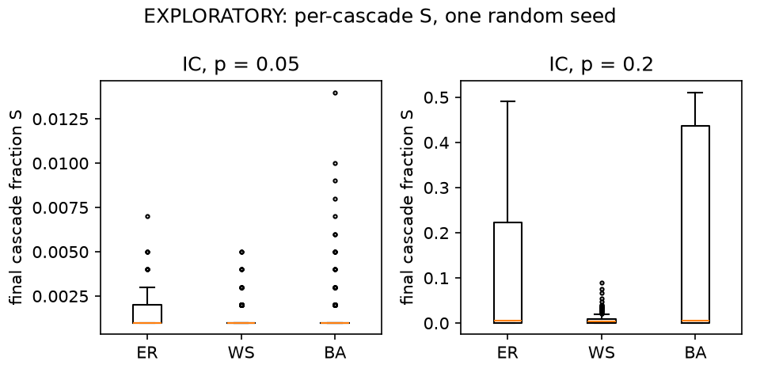
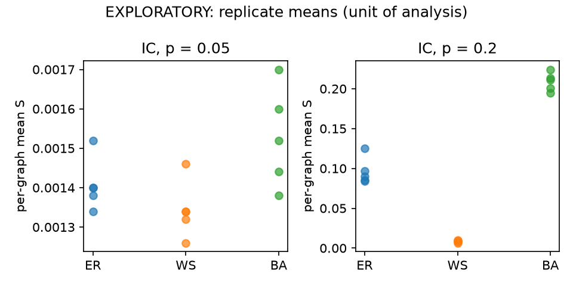

<!-- SPDX-License-Identifier: LicenseRef-VIRAL-NC-Research-1.0 -->
# EXP-001 run report: EXP-001-20261124T162117Z-99c548ac

**EXPLORATORY RUN. Not a finding.** The protocol is not frozen. These numbers are simulation outputs used for engine checks and planning (runtime, seed spread, degenerate cells). They must not be cited as results.

Label: EXPLORATORY smoke matrix (EXP-001 protocol item 8 and 10); engine verification, not a finding

Generated by `viral report` from `result.json` only; every number below is computed from that file.

## Run record

- Config hash: `99c548ac3da117e55003d39e0fb70fa44ad73faaeac858992e8555a9f3b33f25`
- Master seed: 20261124; engine: vectorised
- Git revision: `6edd91e1d23537dae822553fd56edaf08a235545` (dirty: False)
- Started / finished (UTC): 2026-11-24T16:21:17Z / 2026-11-24T16:21:20Z
- Runtime: 3.28 s; process peak RSS: 60653568 bytes
- Versions: python 3.12.1, numpy 2.5.4, networkx 3.7, jsonschema 4.26.0, viral 0.1.0
- OS: macOS-15.3.1-arm64-arm-64bit; CPU: Apple M1 Pro, 10 logical CPUs
- Graphs: 15; cells: 105; cascades: 5250

## Verification checks

- Graphs checked: 15, failures: 0
- Cascades checked: 5250, failures: 0

## Graphs (means over replicates)

| topology | graphs | edges | <k> | <k^2> | max k | p_c | giant comp. | clustering |
|---|---|---|---|---|---|---|---|---|
| er | 5 | 3000.000 | 6.000 | 42.051 | 15.200 | 0.166 | 0.997 | 0.005 |
| ws | 5 | 3000.000 | 6.000 | 36.581 | 9.000 | 0.196 | 1.000 | 0.447 |
| ba | 5 | 2991.000 | 5.982 | 84.839 | 91.000 | 0.076 | 1.000 | 0.032 |

## Cells (mean over replicates of per-graph mean S; spread across replicates)

| model | p or phi | rule | seeds | topology | R | mean S | sd between R | min | max | depth | T50 | Gini | P(S>=0.1) | s/cascade |
|---|---|---|---|---|---|---|---|---|---|---|---|---|---|---|
| ic | 0.0000 | random | 1 | ba | 5 | 0.0010 | 0.0000 | 0.0010 | 0.0010 | 0.0000 | 0.0000 | 0.0000 | 0.0000 | 0.0001 |
| ic | 0.0000 | random | 1 | er | 5 | 0.0010 | 0.0000 | 0.0010 | 0.0010 | 0.0000 | 0.0000 | 0.0000 | 0.0000 | 0.0001 |
| ic | 0.0000 | random | 1 | ws | 5 | 0.0010 | 0.0000 | 0.0010 | 0.0010 | 0.0000 | 0.0000 | 0.0000 | 0.0000 | 0.0001 |
| ic | 0.0500 | random | 1 | ba | 5 | 0.0015 | 0.0001 | 0.0014 | 0.0017 | 0.3680 | 0.1520 | 0.2976 | 0.0000 | 0.0001 |
| ic | 0.0500 | random | 1 | er | 5 | 0.0014 | 0.0001 | 0.0013 | 0.0015 | 0.3600 | 0.0840 | 0.2269 | 0.0000 | 0.0001 |
| ic | 0.0500 | random | 1 | ws | 5 | 0.0013 | 0.0001 | 0.0013 | 0.0015 | 0.3160 | 0.0720 | 0.2069 | 0.0000 | 0.0001 |
| ic | 0.2000 | random | 1 | ba | 5 | 0.2088 | 0.0115 | 0.1949 | 0.2242 | 7.7280 | 3.8320 | 0.5410 | 0.4720 | 0.0006 |
| ic | 0.2000 | random | 1 | er | 5 | 0.0961 | 0.0170 | 0.0837 | 0.1252 | 10.3560 | 5.4880 | 0.7301 | 0.2800 | 0.0004 |
| ic | 0.2000 | random | 1 | ws | 5 | 0.0084 | 0.0013 | 0.0066 | 0.0101 | 3.4200 | 1.6320 | 0.6053 | 0.0000 | 0.0001 |
| ic | 1.0000 | random | 1 | ba | 5 | 1.0000 | 0.0000 | 1.0000 | 1.0000 | 4.8920 | 3.4840 | 0.0000 | 1.0000 | 0.0022 |
| ic | 1.0000 | random | 1 | er | 5 | 0.9972 | 0.0016 | 0.9960 | 0.9990 | 6.3440 | 4.0680 | 0.0000 | 1.0000 | 0.0022 |
| ic | 1.0000 | random | 1 | ws | 5 | 1.0000 | 0.0000 | 1.0000 | 1.0000 | 9.4640 | 6.3520 | 0.0000 | 1.0000 | 0.0022 |
| lt | 0.0000 | random | 1 | ba | 5 | 1.0000 | 0.0000 | 1.0000 | 1.0000 | 4.9720 | 3.5720 | 0.0000 | 1.0000 | 0.0004 |
| lt | 0.0000 | random | 1 | er | 5 | 0.9932 | 0.0097 | 0.9761 | 0.9990 | 6.2960 | 4.0800 | 0.0040 | 0.9960 | 0.0005 |
| lt | 0.0000 | random | 1 | ws | 5 | 1.0000 | 0.0000 | 1.0000 | 1.0000 | 9.4760 | 6.3720 | 0.0000 | 1.0000 | 0.0006 |
| lt | 0.1800 | random | 1 | ba | 5 | 0.2568 | 0.0597 | 0.1639 | 0.3246 | 6.4320 | 4.7840 | 0.7364 | 0.2520 | 0.0003 |
| lt | 0.1800 | random | 1 | er | 5 | 0.2247 | 0.1662 | 0.0858 | 0.5016 | 6.6480 | 4.8480 | 0.7593 | 0.2200 | 0.0003 |
| lt | 0.1800 | random | 1 | ws | 5 | 0.7123 | 0.0878 | 0.6004 | 0.8202 | 25.6000 | 18.2200 | 0.2876 | 0.7120 | 0.0012 |
| lt | 1.0100 | random | 1 | ba | 5 | 0.0010 | 0.0000 | 0.0010 | 0.0010 | 0.0000 | 0.0000 | 0.0000 | 0.0000 | 0.0001 |
| lt | 1.0100 | random | 1 | er | 5 | 0.0010 | 0.0000 | 0.0010 | 0.0010 | 0.0000 | 0.0000 | 0.0000 | 0.0000 | 0.0001 |
| lt | 1.0100 | random | 1 | ws | 5 | 0.0010 | 0.0000 | 0.0010 | 0.0010 | 0.0000 | 0.0000 | 0.0000 | 0.0000 | 0.0001 |

## Replicate-level spread of the primary-style contrast (descriptive, not inference)

Sbar is the mean of per-graph mean S over the parameter values present in this run (IC, one random seed). `R needed` is the replicate count for a 95 percent half-width of 0.01 under a normal approximation; the Holm column uses the first Holm step over two contrasts (z = 2.24).

| contrast | R | mean diff | sd_diff | min | max | half-width at R=30 | R needed | R needed (Holm) |
|---|---|---|---|---|---|---|---|---|
| ba - er | 5 | 0.0289 | 0.0035 | 0.0251 | 0.0334 | 0.0013 | 2 | 2 |
| ws - er | 5 | -0.0213 | 0.0042 | -0.0285 | -0.0183 | 0.0015 | 2 | 2 |

Per parameter value (same contrast, one p at a time; descriptive):

| p | contrast | R | mean diff | sd_diff | min | max |
|---|---|---|---|---|---|---|
| 0.0000 | ba - er | 5 | 0.0000 | 0.0000 | 0.0000 | 0.0000 |
| 0.0000 | ws - er | 5 | 0.0000 | 0.0000 | 0.0000 | 0.0000 |
| 0.0500 | ba - er | 5 | 0.0001 | 0.0001 | 0.0000 | 0.0003 |
| 0.0500 | ws - er | 5 | -0.0001 | 0.0000 | -0.0001 | -0.0000 |
| 0.2000 | ba - er | 5 | 0.1127 | 0.0140 | 0.0990 | 0.1295 |
| 0.2000 | ws - er | 5 | -0.0878 | 0.0160 | -0.1150 | -0.0771 |
| 1.0000 | ba - er | 5 | 0.0028 | 0.0016 | 0.0010 | 0.0040 |
| 1.0000 | ws - er | 5 | 0.0028 | 0.0016 | 0.0010 | 0.0040 |

## Variance decomposition of S (shares of total variance)

| model | p or phi | rule | seeds | total var | topology | replicate | within graph |
|---|---|---|---|---|---|---|---|
| ic | 0.0000 | random | 1 | 0.0000 | 0.0000 | 0.0000 | 0.0000 |
| ic | 0.0500 | random | 1 | 0.0000 | 0.0050 | 0.0059 | 0.9890 |
| ic | 0.2000 | random | 1 | 0.0305 | 0.2210 | 0.0037 | 0.7753 |
| ic | 1.0000 | random | 1 | 0.0000 | 0.7076 | 0.2924 | 0.0000 |
| lt | 0.0000 | random | 1 | 0.0013 | 0.0077 | 0.0188 | 0.9735 |
| lt | 0.1800 | random | 1 | 0.2361 | 0.2101 | 0.0439 | 0.7460 |
| lt | 1.0100 | random | 1 | 0.0000 | 0.0000 | 0.0000 | 0.0000 |

## Degenerate cells

| model | p or phi | rule | seeds | topology | reasons |
|---|---|---|---|---|---|
| ic | 0.0000 | random | 1 | ba | every cascade stayed at its seed set; zero variance across all cascades; 100.0% of cascades stayed at the seed set |
| ic | 0.0000 | random | 1 | er | every cascade stayed at its seed set; zero variance across all cascades; 100.0% of cascades stayed at the seed set |
| ic | 0.0000 | random | 1 | ws | every cascade stayed at its seed set; zero variance across all cascades; 100.0% of cascades stayed at the seed set |
| ic | 1.0000 | random | 1 | ba | zero variance across all cascades; every cascade reached >= 99 percent of nodes |
| ic | 1.0000 | random | 1 | er | every cascade reached >= 99 percent of nodes |
| ic | 1.0000 | random | 1 | ws | zero variance across all cascades; every cascade reached >= 99 percent of nodes |
| lt | 0.0000 | random | 1 | ba | zero variance across all cascades; every cascade reached >= 99 percent of nodes |
| lt | 0.0000 | random | 1 | ws | zero variance across all cascades; every cascade reached >= 99 percent of nodes |
| lt | 1.0100 | random | 1 | ba | every cascade stayed at its seed set; zero variance across all cascades; 100.0% of cascades stayed at the seed set |
| lt | 1.0100 | random | 1 | er | every cascade stayed at its seed set; zero variance across all cascades; 100.0% of cascades stayed at the seed set |
| lt | 1.0100 | random | 1 | ws | every cascade stayed at its seed set; zero variance across all cascades; 100.0% of cascades stayed at the seed set |

## Runtime projection for EXP-002 (config hash `ddc4d324093d`)

- Projected: 32.9 s (0.009 h) on this machine, single process.
- Cells with an exact measured rate: 6; nearest-parameter rate: 15; no rate: 63.
- Scope: engine time plus graph generation only; graph statistics, verification and serialisation excluded.

## Figures

*Exploratory distribution of the final cascade fraction S per cascade, by topology and transmission probability p (IC, one uniformly random seed). Boxes pool all cascades over all graph replicates; cascades on one graph are correlated.*

*Exploratory per-graph mean of S (one point per graph replicate, the independent unit) by topology and p.*

