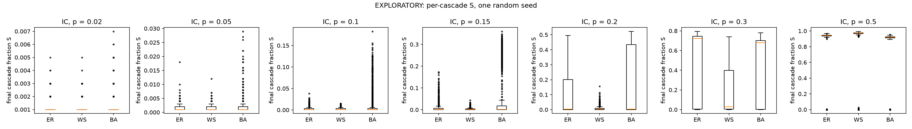
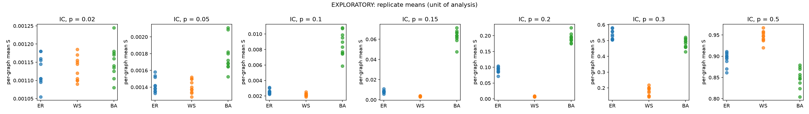

<!-- SPDX-License-Identifier: LicenseRef-VIRAL-NC-Research-1.0 -->
# EXP-001 run report: EXP-001-20261124T162121Z-d947f41d

**EXPLORATORY RUN. Not a finding.** The protocol is not frozen. These numbers are simulation outputs used for engine checks and planning (runtime, seed spread, degenerate cells). They must not be cited as results.

Label: EXPLORATORY planning probe: full EXP-002 and EXP-003 parameter grids at reduced replicates, for runtime projection and seed-spread estimation; not a finding

Generated by `viral report` from `result.json` only; every number below is computed from that file.

## Run record

- Config hash: `d947f41d5aa9859419b9aadf92f017170fb470e0d93932f37d7af2c3e5189597`
- Master seed: 20261124; engine: vectorised
- Git revision: `6edd91e1d23537dae822553fd56edaf08a235545` (dirty: False)
- Started / finished (UTC): 2026-11-24T16:21:21Z / 2026-11-24T16:23:15Z
- Runtime: 114.82 s; process peak RSS: 85884928 bytes
- Versions: python 3.12.1, numpy 2.5.4, networkx 3.7, jsonschema 4.26.0, viral 0.1.0
- OS: macOS-15.3.1-arm64-arm-64bit; CPU: Apple M1 Pro, 10 logical CPUs
- Graphs: 30; cells: 1440; cascades: 288000

## Verification checks

- Graphs checked: 30, failures: 0
- Cascades checked: 0, failures: 0

## Graphs (means over replicates)

| topology | graphs | edges | <k> | <k^2> | max k | p_c | giant comp. | clustering |
|---|---|---|---|---|---|---|---|---|
| er | 10 | 3000.000 | 6.000 | 41.924 | 15.100 | 0.167 | 0.998 | 0.006 |
| ws | 10 | 3000.000 | 6.000 | 36.583 | 9.100 | 0.196 | 1.000 | 0.443 |
| ba | 10 | 2991.000 | 5.982 | 83.768 | 90.400 | 0.077 | 1.000 | 0.030 |

## Cells (mean over replicates of per-graph mean S; spread across replicates)

| model | p or phi | rule | seeds | topology | R | mean S | sd between R | min | max | depth | T50 | Gini | P(S>=0.1) | s/cascade |
|---|---|---|---|---|---|---|---|---|---|---|---|---|---|---|
| ic | 0.0200 | highest_degree | 1 | ba | 10 | 0.0032 | 0.0003 | 0.0028 | 0.0037 | 1.1340 | 0.6095 | 0.3019 | 0.0000 | 0.0001 |
| ic | 0.0200 | highest_degree | 1 | er | 10 | 0.0014 | 0.0000 | 0.0013 | 0.0014 | 0.3180 | 0.0655 | 0.2052 | 0.0000 | 0.0001 |
| ic | 0.0200 | highest_degree | 1 | ws | 10 | 0.0012 | 0.0000 | 0.0012 | 0.0013 | 0.1880 | 0.0310 | 0.1455 | 0.0000 | 0.0001 |
| ic | 0.0200 | highest_degree | 10 | ba | 10 | 0.0221 | 0.0008 | 0.0206 | 0.0235 | 1.8440 | 0.6300 | 0.1009 | 0.0000 | 0.0001 |
| ic | 0.0200 | highest_degree | 10 | er | 10 | 0.0130 | 0.0001 | 0.0128 | 0.0132 | 1.2375 | 0.0010 | 0.0795 | 0.0000 | 0.0001 |
| ic | 0.0200 | highest_degree | 10 | ws | 10 | 0.0118 | 0.0001 | 0.0117 | 0.0120 | 0.9860 | 0.0000 | 0.0671 | 0.0000 | 0.0001 |
| ic | 0.0200 | random | 1 | ba | 10 | 0.0012 | 0.0000 | 0.0011 | 0.0012 | 0.1340 | 0.0300 | 0.1187 | 0.0000 | 0.0000 |
| ic | 0.0200 | random | 1 | er | 10 | 0.0011 | 0.0000 | 0.0011 | 0.0012 | 0.1235 | 0.0150 | 0.1005 | 0.0000 | 0.0000 |
| ic | 0.0200 | random | 1 | ws | 10 | 0.0011 | 0.0000 | 0.0011 | 0.0012 | 0.1250 | 0.0160 | 0.1037 | 0.0000 | 0.0000 |
| ic | 0.0200 | random | 10 | ba | 10 | 0.0116 | 0.0001 | 0.0114 | 0.0118 | 0.9305 | 0.0015 | 0.0735 | 0.0000 | 0.0000 |
| ic | 0.0200 | random | 10 | er | 10 | 0.0113 | 0.0001 | 0.0112 | 0.0114 | 0.8435 | 0.0000 | 0.0590 | 0.0000 | 0.0000 |
| ic | 0.0200 | random | 10 | ws | 10 | 0.0113 | 0.0001 | 0.0112 | 0.0114 | 0.8140 | 0.0000 | 0.0569 | 0.0000 | 0.0000 |
| ic | 0.0500 | highest_degree | 1 | ba | 10 | 0.0098 | 0.0010 | 0.0083 | 0.0117 | 2.5900 | 1.2250 | 0.3350 | 0.0000 | 0.0001 |
| ic | 0.0500 | highest_degree | 1 | er | 10 | 0.0020 | 0.0002 | 0.0018 | 0.0023 | 0.7605 | 0.2730 | 0.3242 | 0.0000 | 0.0001 |
| ic | 0.0500 | highest_degree | 1 | ws | 10 | 0.0016 | 0.0001 | 0.0015 | 0.0018 | 0.5115 | 0.1535 | 0.2750 | 0.0000 | 0.0001 |
| ic | 0.0500 | highest_degree | 10 | ba | 10 | 0.0476 | 0.0023 | 0.0456 | 0.0534 | 3.4135 | 1.0000 | 0.1024 | 0.0000 | 0.0002 |
| ic | 0.0500 | highest_degree | 10 | er | 10 | 0.0190 | 0.0003 | 0.0185 | 0.0195 | 2.2935 | 0.3200 | 0.1179 | 0.0000 | 0.0001 |
| ic | 0.0500 | highest_degree | 10 | ws | 10 | 0.0155 | 0.0003 | 0.0150 | 0.0158 | 1.8060 | 0.0540 | 0.1039 | 0.0000 | 0.0001 |
| ic | 0.0500 | random | 1 | ba | 10 | 0.0018 | 0.0002 | 0.0015 | 0.0021 | 0.4715 | 0.1970 | 0.3749 | 0.0000 | 0.0000 |
| ic | 0.0500 | random | 1 | er | 10 | 0.0014 | 0.0001 | 0.0013 | 0.0016 | 0.3665 | 0.1035 | 0.2391 | 0.0000 | 0.0000 |
| ic | 0.0500 | random | 1 | ws | 10 | 0.0014 | 0.0001 | 0.0013 | 0.0015 | 0.3595 | 0.0925 | 0.2280 | 0.0000 | 0.0000 |
| ic | 0.0500 | random | 10 | ba | 10 | 0.0169 | 0.0009 | 0.0159 | 0.0190 | 2.3680 | 0.3080 | 0.2030 | 0.0000 | 0.0001 |
| ic | 0.0500 | random | 10 | er | 10 | 0.0142 | 0.0002 | 0.0139 | 0.0145 | 1.7785 | 0.0310 | 0.1097 | 0.0000 | 0.0001 |
| ic | 0.0500 | random | 10 | ws | 10 | 0.0139 | 0.0002 | 0.0136 | 0.0142 | 1.6115 | 0.0185 | 0.0987 | 0.0000 | 0.0001 |
| ic | 0.1000 | highest_degree | 1 | ba | 10 | 0.0582 | 0.0050 | 0.0529 | 0.0671 | 7.8360 | 3.3425 | 0.3684 | 0.1665 | 0.0003 |
| ic | 0.1000 | highest_degree | 1 | er | 10 | 0.0046 | 0.0004 | 0.0039 | 0.0053 | 2.0065 | 0.8945 | 0.4421 | 0.0000 | 0.0001 |
| ic | 0.1000 | highest_degree | 1 | ws | 10 | 0.0027 | 0.0001 | 0.0025 | 0.0029 | 1.1855 | 0.4835 | 0.3899 | 0.0000 | 0.0001 |
| ic | 0.1000 | highest_degree | 10 | ba | 10 | 0.1248 | 0.0041 | 0.1189 | 0.1343 | 6.5950 | 1.4630 | 0.0949 | 0.8795 | 0.0002 |
| ic | 0.1000 | highest_degree | 10 | er | 10 | 0.0398 | 0.0011 | 0.0377 | 0.0410 | 5.1405 | 1.1860 | 0.1614 | 0.0000 | 0.0002 |
| ic | 0.1000 | highest_degree | 10 | ws | 10 | 0.0252 | 0.0004 | 0.0247 | 0.0259 | 3.4840 | 0.7710 | 0.1394 | 0.0000 | 0.0002 |
| ic | 0.1000 | random | 1 | ba | 10 | 0.0087 | 0.0016 | 0.0059 | 0.0108 | 1.6820 | 0.8280 | 0.7837 | 0.0190 | 0.0001 |
| ic | 0.1000 | random | 1 | er | 10 | 0.0026 | 0.0003 | 0.0022 | 0.0031 | 1.0550 | 0.4390 | 0.4559 | 0.0000 | 0.0000 |
| ic | 0.1000 | random | 1 | ws | 10 | 0.0022 | 0.0002 | 0.0019 | 0.0025 | 0.8915 | 0.3465 | 0.3768 | 0.0000 | 0.0000 |
| ic | 0.1000 | random | 10 | ba | 10 | 0.0643 | 0.0067 | 0.0565 | 0.0791 | 7.6720 | 2.9535 | 0.3821 | 0.2435 | 0.0001 |
| ic | 0.1000 | random | 10 | er | 10 | 0.0242 | 0.0011 | 0.0222 | 0.0260 | 4.0640 | 0.7390 | 0.1931 | 0.0000 | 0.0001 |
| ic | 0.1000 | random | 10 | ws | 10 | 0.0208 | 0.0005 | 0.0201 | 0.0217 | 3.1395 | 0.4755 | 0.1421 | 0.0000 | 0.0001 |
| ic | 0.1500 | highest_degree | 1 | ba | 10 | 0.2463 | 0.0082 | 0.2366 | 0.2654 | 14.2335 | 5.9845 | 0.1157 | 0.9625 | 0.0005 |
| ic | 0.1500 | highest_degree | 1 | er | 10 | 0.0186 | 0.0015 | 0.0162 | 0.0209 | 5.6585 | 2.7300 | 0.5937 | 0.0205 | 0.0002 |
| ic | 0.1500 | highest_degree | 1 | ws | 10 | 0.0049 | 0.0004 | 0.0043 | 0.0055 | 2.2650 | 1.0365 | 0.4586 | 0.0000 | 0.0001 |
| ic | 0.1500 | highest_degree | 10 | ba | 10 | 0.2681 | 0.0048 | 0.2612 | 0.2782 | 9.5810 | 2.1405 | 0.0651 | 1.0000 | 0.0003 |
| ic | 0.1500 | highest_degree | 10 | er | 10 | 0.1066 | 0.0053 | 0.0960 | 0.1136 | 11.3630 | 3.0205 | 0.1963 | 0.5240 | 0.0003 |
| ic | 0.1500 | highest_degree | 10 | ws | 10 | 0.0433 | 0.0017 | 0.0403 | 0.0461 | 5.8545 | 1.3755 | 0.1633 | 0.0020 | 0.0002 |
| ic | 0.1500 | random | 1 | ba | 10 | 0.0630 | 0.0065 | 0.0476 | 0.0715 | 4.6120 | 2.3030 | 0.7633 | 0.2355 | 0.0001 |
| ic | 0.1500 | random | 1 | er | 10 | 0.0082 | 0.0014 | 0.0057 | 0.0110 | 2.7735 | 1.3560 | 0.6981 | 0.0070 | 0.0001 |
| ic | 0.1500 | random | 1 | ws | 10 | 0.0035 | 0.0003 | 0.0030 | 0.0041 | 1.6230 | 0.7225 | 0.4783 | 0.0000 | 0.0001 |
| ic | 0.1500 | random | 10 | ba | 10 | 0.2573 | 0.0081 | 0.2473 | 0.2759 | 13.8200 | 5.8940 | 0.1273 | 0.9395 | 0.0003 |
| ic | 0.1500 | random | 10 | er | 10 | 0.0651 | 0.0028 | 0.0591 | 0.0683 | 10.0165 | 3.1230 | 0.3176 | 0.1750 | 0.0002 |
| ic | 0.1500 | random | 10 | ws | 10 | 0.0343 | 0.0006 | 0.0329 | 0.0352 | 5.3865 | 1.2370 | 0.1839 | 0.0005 | 0.0001 |
| ic | 0.2000 | highest_degree | 1 | ba | 10 | 0.4351 | 0.0034 | 0.4315 | 0.4433 | 12.8260 | 5.1195 | 0.0393 | 0.9990 | 0.0006 |
| ic | 0.2000 | highest_degree | 1 | er | 10 | 0.1845 | 0.0167 | 0.1586 | 0.2049 | 19.3175 | 9.5640 | 0.4763 | 0.5735 | 0.0005 |
| ic | 0.2000 | highest_degree | 1 | ws | 10 | 0.0101 | 0.0009 | 0.0087 | 0.0115 | 4.0665 | 1.9145 | 0.5240 | 0.0005 | 0.0002 |
| ic | 0.2000 | highest_degree | 10 | ba | 10 | 0.4356 | 0.0026 | 0.4320 | 0.4406 | 9.9925 | 2.5555 | 0.0387 | 1.0000 | 0.0003 |
| ic | 0.2000 | highest_degree | 10 | er | 10 | 0.3421 | 0.0075 | 0.3303 | 0.3517 | 19.7360 | 6.1310 | 0.1033 | 0.9990 | 0.0004 |
| ic | 0.2000 | highest_degree | 10 | ws | 10 | 0.0868 | 0.0036 | 0.0823 | 0.0928 | 10.3715 | 2.6525 | 0.1846 | 0.2965 | 0.0002 |
| ic | 0.2000 | random | 1 | ba | 10 | 0.1930 | 0.0147 | 0.1748 | 0.2253 | 7.1990 | 3.5805 | 0.5731 | 0.4390 | 0.0003 |
| ic | 0.2000 | random | 1 | er | 10 | 0.0910 | 0.0094 | 0.0715 | 0.1037 | 10.3300 | 5.3025 | 0.7343 | 0.2715 | 0.0002 |
| ic | 0.2000 | random | 1 | ws | 10 | 0.0075 | 0.0008 | 0.0065 | 0.0088 | 3.1945 | 1.5320 | 0.5739 | 0.0015 | 0.0001 |
| ic | 0.2000 | random | 10 | ba | 10 | 0.4457 | 0.0028 | 0.4423 | 0.4512 | 12.7850 | 5.2745 | 0.0396 | 0.9960 | 0.0003 |
| ic | 0.2000 | random | 10 | er | 10 | 0.3238 | 0.0063 | 0.3152 | 0.3363 | 23.8250 | 9.3870 | 0.1451 | 0.9660 | 0.0004 |
| ic | 0.2000 | random | 10 | ws | 10 | 0.0681 | 0.0023 | 0.0644 | 0.0717 | 9.8010 | 2.6245 | 0.2179 | 0.1335 | 0.0002 |
| ic | 0.3000 | highest_degree | 1 | ba | 10 | 0.6908 | 0.0024 | 0.6868 | 0.6952 | 10.2635 | 4.1045 | 0.0173 | 1.0000 | 0.0008 |
| ic | 0.3000 | highest_degree | 1 | er | 10 | 0.7131 | 0.0098 | 0.6945 | 0.7238 | 17.1065 | 8.7315 | 0.0454 | 0.9725 | 0.0009 |
| ic | 0.3000 | highest_degree | 1 | ws | 10 | 0.2369 | 0.0235 | 0.2029 | 0.2799 | 25.8740 | 12.7500 | 0.5110 | 0.5585 | 0.0006 |
| ic | 0.3000 | highest_degree | 10 | ba | 10 | 0.6908 | 0.0020 | 0.6876 | 0.6953 | 8.5040 | 2.3450 | 0.0170 | 1.0000 | 0.0003 |
| ic | 0.3000 | highest_degree | 10 | er | 10 | 0.7337 | 0.0021 | 0.7312 | 0.7368 | 13.3955 | 4.9620 | 0.0183 | 1.0000 | 0.0004 |
| ic | 0.3000 | highest_degree | 10 | ws | 10 | 0.4894 | 0.0247 | 0.4527 | 0.5413 | 27.1980 | 8.2610 | 0.1004 | 1.0000 | 0.0005 |
| ic | 0.3000 | random | 1 | ba | 10 | 0.4825 | 0.0295 | 0.4283 | 0.5205 | 8.8890 | 4.5335 | 0.3145 | 0.6970 | 0.0005 |
| ic | 0.3000 | random | 1 | er | 10 | 0.5365 | 0.0301 | 0.5034 | 0.5812 | 13.9470 | 7.6035 | 0.2814 | 0.7315 | 0.0006 |
| ic | 0.3000 | random | 1 | ws | 10 | 0.1801 | 0.0258 | 0.1437 | 0.2181 | 20.5805 | 10.3425 | 0.6259 | 0.4150 | 0.0004 |
| ic | 0.3000 | random | 10 | ba | 10 | 0.6958 | 0.0021 | 0.6929 | 0.6992 | 10.2530 | 4.2010 | 0.0164 | 1.0000 | 0.0003 |
| ic | 0.3000 | random | 10 | er | 10 | 0.7373 | 0.0020 | 0.7345 | 0.7415 | 14.7070 | 6.2555 | 0.0180 | 1.0000 | 0.0004 |
| ic | 0.3000 | random | 10 | ws | 10 | 0.4818 | 0.0212 | 0.4463 | 0.5260 | 30.4015 | 10.3645 | 0.1195 | 0.9955 | 0.0005 |
| ic | 0.5000 | highest_degree | 1 | ba | 10 | 0.9201 | 0.0013 | 0.9180 | 0.9224 | 7.1240 | 3.0305 | 0.0059 | 1.0000 | 0.0009 |
| ic | 0.5000 | highest_degree | 1 | er | 10 | 0.9409 | 0.0029 | 0.9361 | 0.9449 | 9.7840 | 5.3500 | 0.0047 | 1.0000 | 0.0009 |
| ic | 0.5000 | highest_degree | 1 | ws | 10 | 0.9688 | 0.0049 | 0.9577 | 0.9740 | 18.8710 | 10.1650 | 0.0086 | 0.9965 | 0.0011 |
| ic | 0.5000 | highest_degree | 10 | ba | 10 | 0.9201 | 0.0010 | 0.9185 | 0.9220 | 6.0545 | 2.0000 | 0.0058 | 1.0000 | 0.0003 |
| ic | 0.5000 | highest_degree | 10 | er | 10 | 0.9409 | 0.0024 | 0.9367 | 0.9450 | 7.7375 | 3.1305 | 0.0047 | 1.0000 | 0.0004 |
| ic | 0.5000 | highest_degree | 10 | ws | 10 | 0.9720 | 0.0012 | 0.9701 | 0.9736 | 13.8385 | 5.3430 | 0.0053 | 1.0000 | 0.0004 |
| ic | 0.5000 | random | 1 | ba | 10 | 0.8490 | 0.0231 | 0.8044 | 0.8794 | 8.2215 | 4.5230 | 0.0828 | 0.9225 | 0.0008 |
| ic | 0.5000 | random | 1 | er | 10 | 0.8935 | 0.0163 | 0.8612 | 0.9113 | 10.2075 | 6.0180 | 0.0555 | 0.9490 | 0.0008 |
| ic | 0.5000 | random | 1 | ws | 10 | 0.9466 | 0.0133 | 0.9199 | 0.9672 | 19.4090 | 10.8835 | 0.0311 | 0.9740 | 0.0010 |
| ic | 0.5000 | random | 10 | ba | 10 | 0.9213 | 0.0009 | 0.9199 | 0.9225 | 7.2835 | 3.1960 | 0.0059 | 1.0000 | 0.0003 |
| ic | 0.5000 | random | 10 | er | 10 | 0.9416 | 0.0024 | 0.9373 | 0.9452 | 8.4565 | 4.0330 | 0.0045 | 1.0000 | 0.0003 |
| ic | 0.5000 | random | 10 | ws | 10 | 0.9729 | 0.0008 | 0.9715 | 0.9741 | 14.5895 | 6.1570 | 0.0049 | 1.0000 | 0.0004 |
| lt | 0.1000 | highest_degree | 1 | ba | 10 | 1.0000 | 0.0000 | 1.0000 | 1.0000 | 4.9000 | 3.0000 | 0.0000 | 1.0000 | 0.0005 |
| lt | 0.1000 | highest_degree | 1 | er | 10 | 0.9976 | 0.0016 | 0.9960 | 1.0000 | 6.1665 | 4.0000 | 0.0000 | 1.0000 | 0.0005 |
| lt | 0.1000 | highest_degree | 1 | ws | 10 | 1.0000 | 0.0000 | 1.0000 | 1.0000 | 8.8060 | 5.8100 | 0.0000 | 1.0000 | 0.0006 |
| lt | 0.1000 | highest_degree | 10 | ba | 10 | 1.0000 | 0.0000 | 1.0000 | 1.0000 | 3.0000 | 2.0000 | 0.0000 | 1.0000 | 0.0004 |
| lt | 0.1000 | highest_degree | 10 | er | 10 | 0.9976 | 0.0016 | 0.9960 | 1.0000 | 4.5985 | 2.0015 | 0.0000 | 1.0000 | 0.0005 |
| lt | 0.1000 | highest_degree | 10 | ws | 10 | 1.0000 | 0.0000 | 1.0000 | 1.0000 | 6.2840 | 3.0280 | 0.0000 | 1.0000 | 0.0005 |
| lt | 0.1000 | random | 1 | ba | 10 | 0.9491 | 0.0143 | 0.9201 | 0.9700 | 7.3215 | 5.8410 | 0.0509 | 0.9490 | 0.0005 |
| lt | 0.1000 | random | 1 | er | 10 | 0.9896 | 0.0061 | 0.9771 | 0.9990 | 6.4730 | 4.2925 | 0.0080 | 0.9920 | 0.0005 |
| lt | 0.1000 | random | 1 | ws | 10 | 1.0000 | 0.0000 | 1.0000 | 1.0000 | 9.3700 | 6.3235 | 0.0000 | 1.0000 | 0.0005 |
| lt | 0.1000 | random | 10 | ba | 10 | 1.0000 | 0.0000 | 1.0000 | 1.0000 | 5.1255 | 3.7360 | 0.0000 | 1.0000 | 0.0004 |
| lt | 0.1000 | random | 10 | er | 10 | 0.9976 | 0.0016 | 0.9960 | 1.0000 | 5.0770 | 3.0000 | 0.0000 | 1.0000 | 0.0004 |
| lt | 0.1000 | random | 10 | ws | 10 | 1.0000 | 0.0000 | 1.0000 | 1.0000 | 6.8420 | 3.9920 | 0.0000 | 1.0000 | 0.0005 |
| lt | 0.1400 | highest_degree | 1 | ba | 10 | 1.0000 | 0.0000 | 1.0000 | 1.0000 | 5.6000 | 3.9000 | 0.0000 | 1.0000 | 0.0005 |
| lt | 0.1400 | highest_degree | 1 | er | 10 | 0.9976 | 0.0016 | 0.9960 | 1.0000 | 7.3475 | 5.0345 | 0.0000 | 1.0000 | 0.0006 |
| lt | 0.1400 | highest_degree | 1 | ws | 10 | 1.0000 | 0.0000 | 1.0000 | 1.0000 | 9.0700 | 6.0060 | 0.0000 | 1.0000 | 0.0006 |
| lt | 0.1400 | highest_degree | 10 | ba | 10 | 1.0000 | 0.0000 | 1.0000 | 1.0000 | 3.4510 | 2.0000 | 0.0000 | 1.0000 | 0.0004 |
| lt | 0.1400 | highest_degree | 10 | er | 10 | 0.9976 | 0.0016 | 0.9960 | 1.0000 | 5.1000 | 3.0000 | 0.0000 | 1.0000 | 0.0005 |
| lt | 0.1400 | highest_degree | 10 | ws | 10 | 1.0000 | 0.0000 | 1.0000 | 1.0000 | 6.4750 | 3.1160 | 0.0000 | 1.0000 | 0.0005 |
| lt | 0.1400 | random | 1 | ba | 10 | 0.8533 | 0.0248 | 0.8203 | 0.8853 | 8.9265 | 7.4105 | 0.1467 | 0.8530 | 0.0005 |
| lt | 0.1400 | random | 1 | er | 10 | 0.9642 | 0.0152 | 0.9413 | 0.9940 | 8.1535 | 5.9155 | 0.0335 | 0.9665 | 0.0005 |
| lt | 0.1400 | random | 1 | ws | 10 | 1.0000 | 0.0000 | 1.0000 | 1.0000 | 9.9925 | 6.8050 | 0.0000 | 1.0000 | 0.0006 |
| lt | 0.1400 | random | 10 | ba | 10 | 1.0000 | 0.0000 | 1.0000 | 1.0000 | 6.3115 | 4.6220 | 0.0000 | 1.0000 | 0.0005 |
| lt | 0.1400 | random | 10 | er | 10 | 0.9976 | 0.0016 | 0.9960 | 1.0000 | 6.0290 | 3.8980 | 0.0000 | 1.0000 | 0.0005 |
| lt | 0.1400 | random | 10 | ws | 10 | 1.0000 | 0.0000 | 1.0000 | 1.0000 | 7.1580 | 4.0020 | 0.0000 | 1.0000 | 0.0005 |
| lt | 0.1800 | highest_degree | 1 | ba | 10 | 1.0000 | 0.0000 | 1.0000 | 1.0000 | 7.6000 | 5.6000 | 0.0000 | 1.0000 | 0.0006 |
| lt | 0.1800 | highest_degree | 1 | er | 10 | 0.5149 | 0.4706 | 0.0010 | 1.0000 | 9.1325 | 7.0480 | 0.1071 | 0.5130 | 0.0005 |
| lt | 0.1800 | highest_degree | 1 | ws | 10 | 0.7584 | 0.3288 | 0.0020 | 1.0000 | 25.8375 | 18.2275 | 0.1416 | 0.7580 | 0.0013 |
| lt | 0.1800 | highest_degree | 10 | ba | 10 | 1.0000 | 0.0000 | 1.0000 | 1.0000 | 4.0000 | 2.0000 | 0.0000 | 1.0000 | 0.0005 |
| lt | 0.1800 | highest_degree | 10 | er | 10 | 0.9976 | 0.0016 | 0.9960 | 1.0000 | 7.1235 | 4.7355 | 0.0000 | 1.0000 | 0.0006 |
| lt | 0.1800 | highest_degree | 10 | ws | 10 | 1.0000 | 0.0000 | 1.0000 | 1.0000 | 19.1435 | 9.8425 | 0.0000 | 1.0000 | 0.0012 |
| lt | 0.1800 | random | 1 | ba | 10 | 0.2392 | 0.0356 | 0.1814 | 0.3085 | 6.4045 | 4.7710 | 0.7533 | 0.2340 | 0.0003 |
| lt | 0.1800 | random | 1 | er | 10 | 0.2559 | 0.1140 | 0.1016 | 0.4860 | 6.6885 | 4.9370 | 0.7341 | 0.2520 | 0.0003 |
| lt | 0.1800 | random | 1 | ws | 10 | 0.6604 | 0.0423 | 0.5954 | 0.7103 | 23.6515 | 16.9840 | 0.3395 | 0.6600 | 0.0011 |
| lt | 0.1800 | random | 10 | ba | 10 | 0.9957 | 0.0042 | 0.9904 | 1.0000 | 9.4315 | 7.5210 | 0.0043 | 0.9955 | 0.0006 |
| lt | 0.1800 | random | 10 | er | 10 | 0.9976 | 0.0016 | 0.9960 | 1.0000 | 9.5840 | 7.0900 | 0.0000 | 1.0000 | 0.0007 |
| lt | 0.1800 | random | 10 | ws | 10 | 1.0000 | 0.0000 | 1.0000 | 1.0000 | 21.0670 | 11.5565 | 0.0000 | 1.0000 | 0.0012 |
| lt | 0.2200 | highest_degree | 1 | ba | 10 | 1.0000 | 0.0000 | 1.0000 | 1.0000 | 13.4000 | 11.4000 | 0.0000 | 1.0000 | 0.0009 |
| lt | 0.2200 | highest_degree | 1 | er | 10 | 0.0042 | 0.0023 | 0.0010 | 0.0090 | 1.5255 | 0.6805 | 0.1051 | 0.0000 | 0.0002 |
| lt | 0.2200 | highest_degree | 1 | ws | 10 | 0.0227 | 0.0679 | 0.0010 | 0.2158 | 1.6395 | 1.2040 | 0.1112 | 0.0215 | 0.0002 |
| lt | 0.2200 | highest_degree | 10 | ba | 10 | 1.0000 | 0.0000 | 1.0000 | 1.0000 | 4.6520 | 2.4000 | 0.0000 | 1.0000 | 0.0005 |
| lt | 0.2200 | highest_degree | 10 | er | 10 | 0.9806 | 0.0415 | 0.8692 | 1.0000 | 12.1480 | 9.3575 | 0.0169 | 0.9820 | 0.0009 |
| lt | 0.2200 | highest_degree | 10 | ws | 10 | 0.8469 | 0.1335 | 0.6096 | 1.0000 | 38.1710 | 26.3295 | 0.1524 | 0.8450 | 0.0019 |
| lt | 0.2200 | random | 1 | ba | 10 | 0.0094 | 0.0048 | 0.0038 | 0.0145 | 1.5690 | 0.6625 | 0.6903 | 0.0050 | 0.0001 |
| lt | 0.2200 | random | 1 | er | 10 | 0.0023 | 0.0002 | 0.0021 | 0.0026 | 0.9400 | 0.3700 | 0.3564 | 0.0000 | 0.0001 |
| lt | 0.2200 | random | 1 | ws | 10 | 0.0594 | 0.0243 | 0.0229 | 0.0921 | 5.1045 | 4.1260 | 0.9213 | 0.0590 | 0.0002 |
| lt | 0.2200 | random | 10 | ba | 10 | 0.3649 | 0.0807 | 0.2741 | 0.4926 | 9.8820 | 5.9175 | 0.5892 | 0.3495 | 0.0005 |
| lt | 0.2200 | random | 10 | er | 10 | 0.1572 | 0.0471 | 0.0782 | 0.2126 | 7.5385 | 3.5230 | 0.7042 | 0.1310 | 0.0003 |
| lt | 0.2200 | random | 10 | ws | 10 | 0.7670 | 0.0468 | 0.6882 | 0.8565 | 35.2725 | 24.8815 | 0.2322 | 0.7645 | 0.0017 |
| lt | 0.2600 | highest_degree | 1 | ba | 10 | 0.0280 | 0.0079 | 0.0130 | 0.0390 | 3.3000 | 1.0000 | 0.0000 | 0.0000 | 0.0002 |
| lt | 0.2600 | highest_degree | 1 | er | 10 | 0.0023 | 0.0014 | 0.0010 | 0.0050 | 0.8075 | 0.3715 | 0.0722 | 0.0000 | 0.0001 |
| lt | 0.2600 | highest_degree | 1 | ws | 10 | 0.0010 | 0.0000 | 0.0010 | 0.0010 | 0.0000 | 0.0000 | 0.0000 | 0.0000 | 0.0001 |
| lt | 0.2600 | highest_degree | 10 | ba | 10 | 1.0000 | 0.0000 | 1.0000 | 1.0000 | 6.1000 | 3.7495 | 0.0000 | 1.0000 | 0.0007 |
| lt | 0.2600 | highest_degree | 10 | er | 10 | 0.0274 | 0.0058 | 0.0177 | 0.0360 | 3.3480 | 0.8405 | 0.0441 | 0.0000 | 0.0002 |
| lt | 0.2600 | highest_degree | 10 | ws | 10 | 0.7062 | 0.2288 | 0.2476 | 1.0000 | 38.6730 | 26.3035 | 0.2900 | 0.7040 | 0.0020 |
| lt | 0.2600 | random | 1 | ba | 10 | 0.0022 | 0.0001 | 0.0020 | 0.0024 | 0.5070 | 0.2535 | 0.3962 | 0.0000 | 0.0001 |
| lt | 0.2600 | random | 1 | er | 10 | 0.0014 | 0.0000 | 0.0013 | 0.0015 | 0.3535 | 0.0835 | 0.2208 | 0.0000 | 0.0001 |
| lt | 0.2600 | random | 1 | ws | 10 | 0.0030 | 0.0025 | 0.0010 | 0.0060 | 0.2585 | 0.1925 | 0.3659 | 0.0020 | 0.0001 |
| lt | 0.2600 | random | 10 | ba | 10 | 0.0239 | 0.0008 | 0.0227 | 0.0250 | 1.8550 | 0.5630 | 0.1919 | 0.0005 | 0.0001 |
| lt | 0.2600 | random | 10 | er | 10 | 0.0153 | 0.0003 | 0.0148 | 0.0159 | 1.6775 | 0.0555 | 0.1029 | 0.0000 | 0.0001 |
| lt | 0.2600 | random | 10 | ws | 10 | 0.5243 | 0.0534 | 0.4179 | 0.6003 | 31.5895 | 22.2345 | 0.4711 | 0.5220 | 0.0015 |

## Replicate-level spread of the primary-style contrast (descriptive, not inference)

Sbar is the mean of per-graph mean S over the parameter values present in this run (IC, one random seed). `R needed` is the replicate count for a 95 percent half-width of 0.01 under a normal approximation; the Holm column uses the first Holm step over two contrasts (z = 2.24).

| contrast | R | mean diff | sd_diff | min | max | half-width at R=30 | R needed | R needed (Holm) |
|---|---|---|---|---|---|---|---|---|
| ba - er | 10 | 0.0092 | 0.0076 | -0.0015 | 0.0236 | 0.0027 | 3 | 3 |
| ws - er | 10 | -0.0560 | 0.0072 | -0.0690 | -0.0459 | 0.0026 | 3 | 3 |

Per parameter value (same contrast, one p at a time; descriptive):

| p | contrast | R | mean diff | sd_diff | min | max |
|---|---|---|---|---|---|---|
| 0.0200 | ba - er | 10 | 0.0000 | 0.0000 | -0.0000 | 0.0001 |
| 0.0200 | ws - er | 10 | 0.0000 | 0.0000 | -0.0000 | 0.0000 |
| 0.0500 | ba - er | 10 | 0.0003 | 0.0001 | 0.0002 | 0.0005 |
| 0.0500 | ws - er | 10 | -0.0000 | 0.0000 | -0.0001 | 0.0000 |
| 0.1000 | ba - er | 10 | 0.0061 | 0.0016 | 0.0035 | 0.0083 |
| 0.1000 | ws - er | 10 | -0.0004 | 0.0002 | -0.0009 | -0.0002 |
| 0.1500 | ba - er | 10 | 0.0548 | 0.0065 | 0.0395 | 0.0628 |
| 0.1500 | ws - er | 10 | -0.0047 | 0.0013 | -0.0077 | -0.0027 |
| 0.2000 | ba - er | 10 | 0.1019 | 0.0166 | 0.0804 | 0.1401 |
| 0.2000 | ws - er | 10 | -0.0835 | 0.0095 | -0.0972 | -0.0644 |
| 0.3000 | ba - er | 10 | -0.0540 | 0.0327 | -0.0974 | 0.0077 |
| 0.3000 | ws - er | 10 | -0.3564 | 0.0369 | -0.4293 | -0.3098 |
| 0.5000 | ba - er | 10 | -0.0445 | 0.0279 | -0.1040 | -0.0087 |
| 0.5000 | ws - er | 10 | 0.0531 | 0.0242 | 0.0258 | 0.0970 |

## Variance decomposition of S (shares of total variance)

| model | p or phi | rule | seeds | total var | topology | replicate | within graph |
|---|---|---|---|---|---|---|---|
| ic | 0.0200 | highest_degree | 1 | 0.0000 | 0.3709 | 0.0125 | 0.6166 |
| ic | 0.0200 | highest_degree | 10 | 0.0000 | 0.7375 | 0.0071 | 0.2554 |
| ic | 0.0200 | random | 1 | 0.0000 | 0.0006 | 0.0079 | 0.9916 |
| ic | 0.0200 | random | 10 | 0.0000 | 0.0061 | 0.0051 | 0.9888 |
| ic | 0.0500 | highest_degree | 1 | 0.0000 | 0.4919 | 0.0109 | 0.4972 |
| ic | 0.0500 | highest_degree | 10 | 0.0002 | 0.8544 | 0.0070 | 0.1386 |
| ic | 0.0500 | random | 1 | 0.0000 | 0.0119 | 0.0064 | 0.9817 |
| ic | 0.0500 | random | 10 | 0.0000 | 0.0799 | 0.0107 | 0.9094 |
| ic | 0.1000 | highest_degree | 1 | 0.0012 | 0.5707 | 0.0064 | 0.4229 |
| ic | 0.1000 | highest_degree | 10 | 0.0021 | 0.9012 | 0.0025 | 0.0963 |
| ic | 0.1000 | random | 1 | 0.0002 | 0.0481 | 0.0043 | 0.9476 |
| ic | 0.1000 | random | 10 | 0.0011 | 0.3617 | 0.0129 | 0.6255 |
| ic | 0.1500 | highest_degree | 1 | 0.0136 | 0.9025 | 0.0015 | 0.0960 |
| ic | 0.1500 | highest_degree | 10 | 0.0098 | 0.9126 | 0.0017 | 0.0857 |
| ic | 0.1500 | random | 1 | 0.0049 | 0.1492 | 0.0027 | 0.8481 |
| ic | 0.1500 | random | 10 | 0.0119 | 0.8188 | 0.0019 | 0.1793 |
| ic | 0.2000 | highest_degree | 1 | 0.0391 | 0.7784 | 0.0022 | 0.2193 |
| ic | 0.2000 | highest_degree | 10 | 0.0237 | 0.9180 | 0.0010 | 0.0811 |
| ic | 0.2000 | random | 1 | 0.0284 | 0.2027 | 0.0032 | 0.7941 |
| ic | 0.2000 | random | 10 | 0.0281 | 0.8808 | 0.0006 | 0.1187 |
| ic | 0.3000 | highest_degree | 1 | 0.0691 | 0.6965 | 0.0028 | 0.3007 |
| ic | 0.3000 | highest_degree | 10 | 0.0145 | 0.7854 | 0.0128 | 0.2018 |
| ic | 0.3000 | random | 1 | 0.1089 | 0.2259 | 0.0067 | 0.7674 |
| ic | 0.3000 | random | 10 | 0.0167 | 0.7521 | 0.0082 | 0.2396 |
| ic | 0.5000 | highest_degree | 1 | 0.0016 | 0.2544 | 0.0064 | 0.7392 |
| ic | 0.5000 | highest_degree | 10 | 0.0005 | 0.8453 | 0.0045 | 0.1503 |
| ic | 0.5000 | random | 1 | 0.0440 | 0.0362 | 0.0066 | 0.9572 |
| ic | 0.5000 | random | 10 | 0.0005 | 0.8530 | 0.0040 | 0.1430 |
| lt | 0.1000 | highest_degree | 1 | 0.0000 | 0.6316 | 0.3684 | 0.0000 |
| lt | 0.1000 | highest_degree | 10 | 0.0000 | 0.6316 | 0.3684 | 0.0000 |
| lt | 0.1000 | random | 1 | 0.0192 | 0.0252 | 0.0038 | 0.9711 |
| lt | 0.1000 | random | 10 | 0.0000 | 0.6278 | 0.3683 | 0.0040 |
| lt | 0.1400 | highest_degree | 1 | 0.0000 | 0.6316 | 0.3684 | 0.0000 |
| lt | 0.1400 | highest_degree | 10 | 0.0000 | 0.6316 | 0.3684 | 0.0000 |
| lt | 0.1400 | random | 1 | 0.0563 | 0.0694 | 0.0045 | 0.9261 |
| lt | 0.1400 | random | 10 | 0.0000 | 0.6300 | 0.3663 | 0.0037 |
| lt | 0.1800 | highest_degree | 1 | 0.1822 | 0.2153 | 0.5428 | 0.2419 |
| lt | 0.1800 | highest_degree | 10 | 0.0000 | 0.6316 | 0.3684 | 0.0000 |
| lt | 0.1800 | random | 1 | 0.2333 | 0.1625 | 0.0206 | 0.8169 |
| lt | 0.1800 | random | 10 | 0.0014 | 0.0023 | 0.0044 | 0.9934 |
| lt | 0.2200 | highest_degree | 1 | 0.2233 | 0.9687 | 0.0062 | 0.0251 |
| lt | 0.2200 | highest_degree | 10 | 0.0525 | 0.0883 | 0.1118 | 0.7999 |
| lt | 0.2200 | random | 1 | 0.0205 | 0.0315 | 0.0090 | 0.9595 |
| lt | 0.2200 | random | 10 | 0.2250 | 0.2849 | 0.0146 | 0.7006 |
| lt | 0.2600 | highest_degree | 1 | 0.0002 | 0.8893 | 0.1102 | 0.0004 |
| lt | 0.2600 | highest_degree | 10 | 0.2337 | 0.7099 | 0.0672 | 0.2229 |
| lt | 0.2600 | random | 1 | 0.0007 | 0.0007 | 0.0029 | 0.9964 |
| lt | 0.2600 | random | 10 | 0.1379 | 0.4105 | 0.0062 | 0.5833 |

## Degenerate cells

| model | p or phi | rule | seeds | topology | reasons |
|---|---|---|---|---|---|
| lt | 0.1000 | highest_degree | 1 | ba | zero variance across all cascades; every cascade reached >= 99 percent of nodes |
| lt | 0.1000 | highest_degree | 1 | er | every cascade reached >= 99 percent of nodes |
| lt | 0.1000 | highest_degree | 1 | ws | zero variance across all cascades; every cascade reached >= 99 percent of nodes |
| lt | 0.1000 | highest_degree | 10 | ba | zero variance across all cascades; every cascade reached >= 99 percent of nodes |
| lt | 0.1000 | highest_degree | 10 | er | every cascade reached >= 99 percent of nodes |
| lt | 0.1000 | highest_degree | 10 | ws | zero variance across all cascades; every cascade reached >= 99 percent of nodes |
| lt | 0.1000 | random | 1 | ws | zero variance across all cascades; every cascade reached >= 99 percent of nodes |
| lt | 0.1000 | random | 10 | ba | zero variance across all cascades; every cascade reached >= 99 percent of nodes |
| lt | 0.1000 | random | 10 | er | every cascade reached >= 99 percent of nodes |
| lt | 0.1000 | random | 10 | ws | zero variance across all cascades; every cascade reached >= 99 percent of nodes |
| lt | 0.1400 | highest_degree | 1 | ba | zero variance across all cascades; every cascade reached >= 99 percent of nodes |
| lt | 0.1400 | highest_degree | 1 | er | every cascade reached >= 99 percent of nodes |
| lt | 0.1400 | highest_degree | 1 | ws | zero variance across all cascades; every cascade reached >= 99 percent of nodes |
| lt | 0.1400 | highest_degree | 10 | ba | zero variance across all cascades; every cascade reached >= 99 percent of nodes |
| lt | 0.1400 | highest_degree | 10 | er | every cascade reached >= 99 percent of nodes |
| lt | 0.1400 | highest_degree | 10 | ws | zero variance across all cascades; every cascade reached >= 99 percent of nodes |
| lt | 0.1400 | random | 1 | ws | zero variance across all cascades; every cascade reached >= 99 percent of nodes |
| lt | 0.1400 | random | 10 | ba | zero variance across all cascades; every cascade reached >= 99 percent of nodes |
| lt | 0.1400 | random | 10 | er | every cascade reached >= 99 percent of nodes |
| lt | 0.1400 | random | 10 | ws | zero variance across all cascades; every cascade reached >= 99 percent of nodes |
| lt | 0.1800 | highest_degree | 1 | ba | zero variance across all cascades; every cascade reached >= 99 percent of nodes |
| lt | 0.1800 | highest_degree | 10 | ba | zero variance across all cascades; every cascade reached >= 99 percent of nodes |
| lt | 0.1800 | highest_degree | 10 | er | every cascade reached >= 99 percent of nodes |
| lt | 0.1800 | highest_degree | 10 | ws | zero variance across all cascades; every cascade reached >= 99 percent of nodes |
| lt | 0.1800 | random | 10 | er | every cascade reached >= 99 percent of nodes |
| lt | 0.1800 | random | 10 | ws | zero variance across all cascades; every cascade reached >= 99 percent of nodes |
| lt | 0.2200 | highest_degree | 1 | ba | zero variance across all cascades; every cascade reached >= 99 percent of nodes |
| lt | 0.2200 | highest_degree | 10 | ba | zero variance across all cascades; every cascade reached >= 99 percent of nodes |
| lt | 0.2600 | highest_degree | 1 | ws | every cascade stayed at its seed set; zero variance across all cascades; 100.0% of cascades stayed at the seed set |
| lt | 0.2600 | highest_degree | 10 | ba | zero variance across all cascades; every cascade reached >= 99 percent of nodes |
| lt | 0.2600 | random | 1 | ws | 99.7% of cascades stayed at the seed set |

## Runtime projection for EXP-002 (config hash `ddc4d324093d`)

- Projected: 141.5 s (0.039 h) on this machine, single process.
- Cells with an exact measured rate: 84; nearest-parameter rate: 0; no rate: 0.
- Scope: engine time plus graph generation only; graph statistics, verification and serialisation excluded.

## Figures

*Exploratory distribution of the final cascade fraction S per cascade, by topology and transmission probability p (IC, one uniformly random seed). Boxes pool all cascades over all graph replicates; cascades on one graph are correlated.*

*Exploratory per-graph mean of S (one point per graph replicate, the independent unit) by topology and p.*

